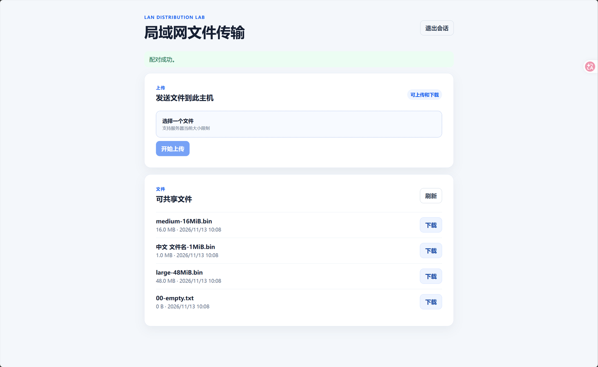

# LAN Distribution Lab

**计算机网络课程项目：基于 HTTP/TCP 与 UDP 服务发现的局域网文件传输系统**

LAN Distribution Lab 是一个可以在局域网中运行的文件收发应用。Windows 电脑作为中心服务器，手机和平板通过浏览器直接访问，完成配对、上传和下载；Python 命令行客户端提供断点续传、多客户端下载调度，以及实验记录与分析功能。

项目以普通文件传输为起点，重点解决文件版本和完整性校验、下载中断恢复、多个客户端同时访问及任务状态记录等问题。应用不需要公网服务器，也不是 P2P 文件块交换系统。

**[阅读完整课程实验报告](docs/EXPERIMENT_REPORT.md)** · [查看项目源码](src/lan_distribution_lab/) · [查看 Web 页面](web/src/)

## 项目运行界面



*Windows 电脑浏览器中的文件列表和操作界面。*

还可以查看报告中的[手机、平板与 Wi-Fi 中断截图](docs/EXPERIMENT_REPORT.md#四程序运行与界面展示)。这四张图片均来自实际设备操作。

## 功能概览

| 模块 | 主要功能 |
| --- | --- |
| Web 文件管理 | 响应式页面、文件列表、上传进度、浏览器下载 |
| 访问授权 | 一次性配对码、只读/读写会话、退出与撤销 |
| 文件正确性 | 分块读写、受控存储目录、SHA-256、文件版本标识 |
| 可靠下载 | Python CLI 的 Range、If-Range、ETag、`.part` 恢复及最终校验 |
| 多客户端分发 | 顺序、普通并发、固定上限受控并发和独立任务记录 |
| 服务发现 | 可选 UDP 广播发现，支持手动 IP 回退 |
| 实验分析 | JSON/CSV 原始记录、描述统计、SVG 图表和 Markdown 汇总 |

## 实际验证

在 Windows 电脑、手机和平板组成的局域网环境中，已完成独立配对、文件收发、1 MiB 双向文件哈希核验、48 MiB 文件下载、双终端同时请求以及 Wi-Fi 中断行为观察。手机浏览器断网后最终重新下载了完整文件；这不等同于 Python CLI 的安全续传。详情、截图和哈希数据见[实验报告](docs/EXPERIMENT_REPORT.md)。

程序在 Windows GitHub Actions 中通过了 173 项 Python 测试和 2 项前端测试，前端构建成功。[查看测试记录](https://github.com/cppppercy/lan-distribution-lab/actions/runs/42847067827)。

**尚未进行的项目：** 正式三策略真实无线性能对照、真实 UDP 广播及 Wireshark 抓包。现有实验驱动中的多个客户端属于控制器内部的逻辑会话，不能直接等同于多台真实无线设备。

## 技术结构

- **服务端：** Python、FastAPI、Uvicorn、SQLite。
- **浏览器页面：** Vue 3、TypeScript、Vite。
- **下载和实验工具：** Python CLI、JSON/CSV、静态 SVG。
- **网络通信：** HTTP/1.1 over TCP，UDP 仅用于可选发现。
- **代码位置：** [HTTP 服务及客户端](src/lan_distribution_lab/)、[Web 页面](web/src/)、[自动化测试](tests/)。

更多资料：[实验报告](docs/EXPERIMENT_REPORT.md) · [架构说明](docs/ARCHITECTURE.md) · [实验记录](docs/EXPERIMENTS.md)。任务日志、需求基线和开发决策保留在 `docs/` 中，供需要追踪具体实现的读者查阅。

> 安全说明：默认仅监听 `127.0.0.1`，局域网监听需要显式启动。目前使用 HTTP，未提供 TLS 加密，适合可信局域网实验，不建议直接暴露到公网。

## 安装和运行

### 前置条件

- Windows PowerShell 5.1+。
- Python 3.12 或 3.13。可用 `py -0p` 查看已安装解释器；T001 的本地验证使用 Python 3.13，CI 固定使用 Python 3.12。

### 安装

在仓库根目录执行：

```powershell
py -3.12 -m venv .venv
.\.venv\Scripts\Activate.ps1
python -m pip install -c requirements.lock -e ".[dev]"
```

如果系统未安装 Python 3.12，可将第一条中的 `-3.12` 替换为已安装的 Python 3.13。直接依赖在 `pyproject.toml` 精确固定，传递依赖由 `requirements.lock` 约束；不要把 `.venv`、`.env` 或密钥提交到仓库。

### 启动本机服务

```powershell
python -m lan_distribution_lab
```

该入口固定监听 `http://127.0.0.1:8000`，不会默认开放局域网或修改 Windows 防火墙。保持该终端运行后，在另一 PowerShell 窗口验证：

```powershell
Invoke-RestMethod http://127.0.0.1:8000/api/health
```

预期输出：

```text
status service
------ -------
ok     lan-distribution-lab
```

### 本机生成配对码

配对码只能由 Windows 主机上的命令行生成，**没有**对应的 LAN 管理 HTTP 接口。为避免“生成码的状态库”和服务端不一致，`pair create` 与 `serve` 必须使用同一组绝对 `--data-dir` 和 `--managed-root`；两个目录必须分离。

```powershell
$dataDir = Join-Path $env:LOCALAPPDATA "LANDistributionLab\state"
$managedRoot = Join-Path $env:LOCALAPPDATA "LANDistributionLab\managed"

python -m lan_distribution_lab pair create --scope read --data-dir $dataDir --managed-root $managedRoot
python -m lan_distribution_lab serve --data-dir $dataDir --managed-root $managedRoot
```

`--scope` 可取 `read`（默认）或 `read_write`。命令显示一个由密码学安全随机数生成的六位数字码及 UTC 过期时间；它只能使用一次，默认十分钟过期。服务端使用同一 SQLite 状态库，以原子事务兑换码并创建最多八小时的会话。

`POST /api/pairings` 已实现：浏览器必须提供与配置精确匹配的 `Origin`，成功后得到 `HttpOnly; SameSite=Strict; Path=/api` Cookie；CLI 才会在 JSON 响应体中一次性得到 Bearer token。服务端只保存 HMAC 摘要，不在 URL 或应用错误中输出令牌。`DELETE /api/sessions/current` 可撤销当前会话；Cookie 会话的撤销同样检查 `Origin`。

当前 HTTP 未启用 TLS，Cookie 的 `Secure` 属性必须为假才能在 HTTP 工作。这些控制能拒绝未持有凭据的请求、缩短凭据有效期并抵御常见 CSRF；**不能**防止同一局域网的窃听或中间人。不要把配对码或 CLI token 发送给不可信对象，也不要将本机服务暴露到公网。

### 文件 API

服务启动后，已配对的 `read_write` 会话可调用 `POST /api/uploads` 上传一个 `multipart/form-data` 文件；已配对的 `read` 会话可调用 `GET /api/files`、`GET /api/files/{file_id}` 及 `GET /api/files/{file_id}/content`。上传使用受控 `staging/`、服务器 UUID 对象名和 SHA-256；下载带强 ETag、安全下载名和 `Accept-Ranges: bytes`，支持单一 `Range` 与强 ETag `If-Range`：可满足范围为 `206`，过期/不匹配版本回退完整 `200`，不可满足范围为 `416`。暂不支持多范围、上传续传或上传幂等键。

### Python CLI 安全断点续传

先从文件列表或元数据响应取得 `file_id`，再在 Windows PowerShell 中执行。默认会以**不回显**的方式提示输入 CLI Bearer token；token 不会写入命令历史、URL、日志、`.part` 或状态 JSON：

```powershell
python -m lan_distribution_lab download `
  --server http://192.168.137.1:8000 `
  --file-id 12345678-1234-5678-1234-567812345678 `
  --output "$HOME\Downloads\课程资料.pdf"
```

也可由一次性配对码即时取得 token，并只在本次 CLI 进程内存中使用。先在主机生成一个 `read` 码，然后在下载命令中加 `--pair`；两次提示的输入都不回显：

```powershell
python -m lan_distribution_lab pair create --scope read --data-dir $dataDir --managed-root $managedRoot
python -m lan_distribution_lab download `
  --server http://192.168.137.1:8000 `
  --file-id 12345678-1234-5678-1234-567812345678 `
  --output "$HOME\Downloads\课程资料.pdf" `
  --pair
```

下载写入同目录的 `课程资料.pdf.part` 和 `课程资料.pdf.part.json`。连接中断后，用相同的服务器、`file_id` 和输出路径再次执行命令；客户端会核对保存的强 ETag、对象大小和已落盘长度，再发送 `Range: bytes=<已完成>-` 与 `If-Range`。每块落盘并原子更新状态，完成后流式验证 SHA-256，随后以不覆盖已有目标的原子硬链接发布最终文件。

如果服务器回退完整 `200`、返回 `416`、ETag/Content-Range 不匹配、本地状态不一致或 SHA-256 失败，客户端绝不会把新字节追加到旧 `.part`；旧工件会改名为 `.stale-<随机值>` 后从头获取。网络故障默认最多重试 2 次（可用 `--retries` 调整），每个 HTTP 请求默认 15 秒超时（`--timeout`）。`--token-stdin` 仅供调用方已能安全保护标准输入的场景；日常优先使用默认不回显提示或 `--pair`。

### 多客户端协同分发

`distribute` 用多个**独立会话**把同一文件分别下载到本机多个逻辑客户端目录，复用 T006 的 `ResumableDownloader`，因此每个客户端仍执行强 ETag 校验、Range/If-Range 续传、最终 SHA-256 验证和不覆盖已有目标的发布。它是中心服务器模式下的控制器：逻辑客户端是独立的 Bearer 会话，但不是真实远程设备。支持三种策略：`sequential`（逐个执行）、`parallel`（全部同时启动，受安全上限约束）、`controlled`（固定并发上限，FIFO 排队）。

先为每个逻辑客户端准备独立凭据。推荐在主机为每个客户端生成一个一次性 `read` 配对码，然后在 `distribute` 中用 `--pair` 依次无回显输入；也可以由调用方通过安全管道用 `--tokens-stdin` 每行提供一个 token：

```powershell
# 两个逻辑客户端 → 在主机执行两次，各生成一个一次性 read 配对码
python -m lan_distribution_lab pair create --scope read --data-dir $dataDir --managed-root $managedRoot

# 顺序分发：前一个客户端完成后才启动下一个
python -m lan_distribution_lab distribute `
  --server http://127.0.0.1:8000 `
  --file-id 12345678-1234-5678-1234-567812345678 `
  --strategy sequential --clients 2 `
  --output-dir "$HOME\Downloads\distribution" `
  --pair

# 并发分发：两个客户端同时发起下载
python -m lan_distribution_lab distribute `
  --server http://127.0.0.1:8000 `
  --file-id 12345678-1234-5678-1234-567812345678 `
  --strategy parallel --clients 2 `
  --output-dir "$HOME\Downloads\distribution" `
  --pair

# 受控并发：最多同时执行 2 个客户端任务，其余按提交顺序排队
python -m lan_distribution_lab distribute `
  --server http://127.0.0.1:8000 `
  --file-id 12345678-1234-5678-1234-567812345678 `
  --strategy controlled --clients 5 --max-concurrent 2 `
  --output-dir "$HOME\Downloads\distribution-controlled" `
  --pair
```

每个客户端写入 `--output-dir/client-<n>/<--output-name>`（默认 `download.bin`），互不覆盖；若目标文件已存在且内容不同，该客户端失败而不会覆盖用户文件。**同一次分发中的多个客户端必须使用不同的 Bearer token**，重复凭据会在下载开始前被拒绝且错误信息不回显 token；`--pair` 为每个逻辑客户端使用独立的一次性配对码。`--max-concurrent N` 仅用于 `controlled`，N 必须为 1..客户端数且不超过安全上限；缺失或误用于其他策略会在下载开始前报错。`--results` 与 `--records` 会在下载启动前做规范化路径校验（解析 `..`、符号链接别名与 Windows 大小写差异）：两者不得使用同一路径，也不得与任何客户端目标、`.part` 或 `.part.json` 冲突；冲突时立即失败，不启动下载、不写结果、不改变已有文件。结果写入 `--output-dir/distribution-result.json`（原子替换；`schema_version: 2`，含 `run_id`、策略、`scheduling.max_concurrent`/`observed_max_active`、文件 SHA-256、每个客户端的排队时间戳/`wait_seconds`/执行时间/字节数/复用字节/安全错误类型，以及成功/失败/取消汇总；v1 字段语义不变），并追加独立 SQLite 记录 `--output-dir/distribution-runs.db`（只追加；打开 T007 旧库时原地迁移并保留历史记录）。`--stop-on-error` 只适用于 `sequential`，会把未开始的客户端标记为 `cancelled`。客户端数上限为 8；`parallel`/`controlled` 的真实重叠由本机服务器同时在途请求测试证明，但这不等于真实多设备分发。排队等待、客户端执行时间与批次总耗时是三个独立指标，测试不据此宣称某种策略更快。

### 可重复分发实验

`experiment` 复用既有下载器和三种分发策略，按固定顺序 `round → file_id → strategy` 逐轮执行；每轮使用新的目录，所以完整下载不会因已有目标文件或 T006 缓存被跳过。它只创建**本机控制器中的逻辑客户端**，即使服务器使用 LAN 地址，也不能据此称为手机、平板或真实 Wi-Fi 实验。

```powershell
# 先为 3 个逻辑客户端各创建一个独立的 read 配对码。
python -m lan_distribution_lab experiment `
  --server http://127.0.0.1:8000 `
  --file-id 12345678-1234-5678-1234-567812345678 `
  --strategies sequential,parallel,controlled `
  --clients 3 --max-concurrent 2 --rounds 3 `
  --environment-type local_loopback `
  --output-dir .\experiments\baseline-001 `
  --pair
```

`--pair` 会无回显地依次要求输入 3 个一次性配对码，所得 Bearer token 仅在这次进程内存中复用，不写入命令行、日志或导出文件。若调用方已安全管理 stdin，也可用 `--tokens-stdin` 提供恰好 N 行不同 token。`--file-id` 可重复指定（最多 4 个）；客户端最多 8 个、轮次最多 10、总 trial 最多 100。`controlled` 才允许 `--max-concurrent`，取值必须在 1..客户端数内。

输出目录必须是从未存在的新目录，结构固定为 `experiments.json`、`trials.csv`、`clients.csv` 和 `trials/trial-<序号>/distribution-result.json`（成功 trial 的原始 `DistributionRun`）。`trials.csv` 的 `application_payload_bytes` 是成功客户端数 × 文件大小，`application_payload_throughput_Bps` 是该值除以批次 `duration_seconds`，只表示应用层有效载荷/批次墙钟时间，**不是**链路带宽。`experiments.json` 含环境标签、Git/Python/平台、试验索引和按策略的描述性统计；成功率使用全部 trial，时间/吞吐量统计只使用完全成功的 trial。**只有全部计划 trial 均成功时整体 `state` 才为 `completed`，且 CLI 返回 0。**continue 模式会继续后续轮次，但任一失败会使整体为 `completed_with_failures` 并返回非零；stop 模式会把未开始轮次标为取消，整体为 `completed_with_cancelled_trials` 并返回非零。两种非完整成功情形都会先打印输出目录并保留已生成 JSON/CSV；Ctrl+C 则记录 `interrupted` 并返回 130。真实 Wi-Fi/设备验证步骤与数据字典见 [实验记录](docs/EXPERIMENTS.md)。

### 实验数据分析与图表

`analyze` 只读校验一个或多个 T010 结果目录，再在**全新**输出目录写入 `analysis.json`、`report.md` 和静态 SVG 图表；不会改写输入 CSV/JSON，也不读取或上传 PCAP。输出目录不得位于任一输入目录内（包括绝对、相对和可解析的符号链接别名），否则会在创建目录前拒绝。计划中的每个 `round × file_id × strategy` 必须恰好出现一次；每份原始 `DistributionRun` 必须唯一且位于对应 `trial-<序号>` 目录。格式、trial/client 计数、原始 DistributionRun、有限数值和状态必须一致；不完整或不兼容的数据会明确失败，不生成看似可信的图。

```powershell
python -m lan_distribution_lab analyze `
  --input .\experiments\exp-20261110-local-001 `
  --output-dir .\analysis\report-001

# 多个结果目录仅在相同文件版本、客户端数、环境、超时/重试和脱敏服务器身份等可比条件内分别汇总
python -m lan_distribution_lab analyze `
  --input .\experiments\run-a --input .\experiments\run-b `
  --metrics duration,throughput,success,controlled,client-timing `
  --output-dir .\analysis\comparison-001
```

报告按策略展示完整成功率（分母含失败/取消）、成功 trial 的批次时间和应用层有效吞吐量（MiB/s，1024 进制）、controlled 的上限/观测活跃数、客户端排队/执行时间，以及在数据足够时的 Jain 公平性。跨服务器或无法证明相同实验环境的 controlled 上限不会合并为对照；报告只给出稳定的脱敏服务器摘要，不回显地址。吞吐量不是 TCP/NIC 带宽，逻辑客户端也不是独立无线设备；报告不生成因果或显著性结论。未提供抓包摘要时会明确写为“没有抓包证据”。可选 `--packet-summary` 只接受有大小、数量和字段值限制的脱敏 schema-v1 JSON 白名单字段；Windows/Wireshark 操作、过滤器和隐私处理见 [抓包证据指南](docs/PACKET_CAPTURE_GUIDE.md)。

### UDP 局域网发现（可选）

服务**默认不启用** UDP 发现，`127.0.0.1` 默认模式不会向局域网广播。显式启用后，服务在 UDP 端口（默认 `47800`）响应发现请求；发现只返回连接候选，**不授予任何权限**，仍需六位一次性配对码完成认证。

```powershell
# 服务端：显式私有 LAN 地址 + 可选发现（UDP 绑定与 HTTP 绑定策略分离）
python -m lan_distribution_lab serve --host 192.168.1.23 --port 8000 `
  --discover --discover-port 47800 --service-name "Study PC"

# 另一台 Windows 电脑：发现服务（默认目标 255.255.255.255，2 秒超时）
python -m lan_distribution_lab discover --timeout 2

# 多网卡/指定广播域：指定目标广播地址与本地源地址
python -m lan_distribution_lab discover --broadcast 192.168.1.255 --interface 192.168.1.23

# 机器可读输出
python -m lan_distribution_lab discover --json
```

`--discover` 只接受私有 LAN IPv4 的 `--host`（拒绝 loopback）；`--discover-port`、`--discover-bind`（默认 `0.0.0.0`，也可指定某网卡的私有/回环 IPv4）与 `--service-name` 只能与 `--discover` 一起使用。Windows 防火墙可能阻止入站 UDP，本项目**不会自动修改防火墙**；需要时由用户手动放行该 UDP 端口。`scripts/start-lan.ps1 -EnableDiscovery -DiscoveryPort 47800` 可在启动脚本中显式开启。

发现结果列出服务名称、IP、HTTP 端口、完整 URL 与协议版本。发现超时会提示手动访问 `http://<LAN-IP>:<HTTP-PORT>/`；手机和平板仍用浏览器打开该 URL 并输入一次性配对码。UDP 广播只在当前广播域有效，校园 Wi-Fi、客户端隔离或跨 VLAN 可能不可用；本项目不实现浏览器 UDP 发现、二维码（当前未实现，手动输入 URL 即可）或云端发现。

### 构建并使用 Web 页面

先构建一次 Vue 页面；构建产物不提交到 Git，但 `python -m lan_distribution_lab serve` 会从 `web/dist` 同源提供它：

```powershell
npm --prefix web ci
npm --prefix web run build
python -m lan_distribution_lab serve --data-dir $dataDir --managed-root $managedRoot
```

在电脑浏览器打开 `http://127.0.0.1:8000/`，输入由本机 `pair create --scope read_write` 生成的六码配对码。浏览器只持有 HttpOnly Cookie；页面不会保存或展示访问 token。上传使用浏览器实际可获得的进度事件。点击“下载”只表示浏览器已收到下载请求，是否保存完成请以浏览器下载列表为准。

### 显式局域网启动（Windows）

默认命令仍只监听 `127.0.0.1`。要让同一家庭 Wi-Fi 的手机或平板访问，先在主机 PowerShell 中确认要使用的**具体私有 IPv4**（例如 `192.168.1.23`），构建页面并使用该地址启动：

最方便的方式是运行仓库内的显式 LAN 启动脚本。它每次启动时自动构建 Web 页面、创建读写配对码，并在 Windows 移动热点存在时优先选择其标准地址 `192.168.137.1`；否则仅在能安全确定单一私有 IPv4 时自动选择。它不会绑定 `0.0.0.0`，也不会修改 Windows 防火墙、NAT 或路由器设置：

```powershell
powershell -NoProfile -ExecutionPolicy Bypass -File .\scripts\start-lan.ps1
```

脚本会打印手机/平板应访问的 URL 和一次性配对码；保持该窗口打开，按 `Ctrl+C` 停止服务。多网卡且无法安全判断时，或想指定端口时，显式传入参数：

```powershell
powershell -NoProfile -ExecutionPolicy Bypass -File .\scripts\start-lan.ps1 `
  -ListenAddress 192.168.137.1 -Port 8000
```

只查看脚本选择的地址、不构建也不启动服务：

```powershell
powershell -NoProfile -ExecutionPolicy Bypass -File .\scripts\start-lan.ps1 -PrintOnly
```

仍可使用下面的底层手动命令；此时 `pair create` 与 `serve` 必须使用相同的存储目录：

```powershell
ipconfig
$lanIp = "192.168.1.23" # 替换为本机 Wi-Fi 的 IPv4，不要写 0.0.0.0
$dataDir = Join-Path $env:LOCALAPPDATA "LANDistributionLab\state"
$managedRoot = Join-Path $env:LOCALAPPDATA "LANDistributionLab\managed"
npm --prefix web ci
npm --prefix web run build
python -m lan_distribution_lab pair create --scope read_write --data-dir $dataDir --managed-root $managedRoot
python -m lan_distribution_lab serve --host $lanIp --port 8000 --data-dir $dataDir --managed-root $managedRoot
```

访问地址为 `http://<你的 LAN IP>:8000/`，例：`http://192.168.1.23:8000/`。`--host` 只接受回环或私有 IPv4，拒绝 `0.0.0.0` 和公网地址；未显式传入 `--origin` 时，浏览器 Origin 自动设置为该 URL，Cookie 配对、上传和退出会话可同源工作。项目不会修改 Windows 防火墙、端口映射或公网设置。

手机/平板人工测试：连接同一 Wi-Fi；先用浏览器打开上述 URL、输入刚生成的配对码；建议先上传/下载一个中文名 1–10 MB 文件和一个空文件，再在浏览器下载列表确认保存完成并核对 SHA-256。记录设备型号、浏览器、Wi-Fi/热点、文件大小、上传结果、下载保存结果和错误信息。若打不开页面，依次检查 IP 是否为当前 Wi-Fi IPv4、设备是否同网段、服务终端是否仍运行，以及 Windows 防火墙/路由器客户端隔离策略；本项目不会自动改变这些系统设置。

默认资源限制为单文件 64 MiB、请求 64 MiB + 128 KiB、受控对象总额 1 GiB、保留 64 MiB 磁盘空间、同时上传 2/下载 8。超限、配额不足或 `ENOSPC` 会失败且不发布部分文件。`managed_root/objects` 和 `managed_root/staging` 仅由服务端生成 UUID 名称；客户端文件名不会成为磁盘路径。

### 运行自动化测试

```powershell
python -m pytest
npm --prefix web run test
npm --prefix web run build
```

当前自动化测试覆盖健康接口、配对码一次性/过期/并发兑换、限速、Cookie/Bearer、权限范围、撤销、Origin、摘要存储与重启持久化；也覆盖显式 LAN host/Origin、静态页面不遮蔽 API、同源前端 API 调用，以及 T007 的顺序/并发分发、独立会话隔离、超时/认证失败/槽位上限、Range 续传、JSON/SQLite 运行记录，和 T008 的固定并发上限（在途请求计数与同步屏障）、FIFO 排队、等待/执行/批次计时、旧库迁移与参数校验。它不等同于手机、平板、真实 Wi-Fi、Windows ACL/reparse point 或真实浏览器下载保存验证。详见 [当前架构](docs/ARCHITECTURE.md)、[威胁模型](docs/THREAT_MODEL.md) 与 [实验记录](docs/EXPERIMENTS.md)。
