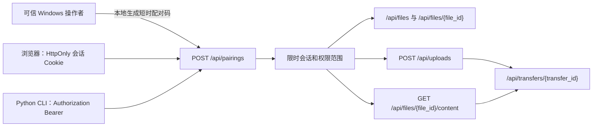

# 文件 API 契约（T002 设计）

**状态**：设计已完成，尚未实现。除既有 `GET /api/health` 外，本文件中的所有端点均为 T003 及后续任务的契约，不能据此宣称已经具备文件传输或授权能力。

## 1. 范围、版本与通用约定

本契约面向同源移动浏览器和 Python CLI。基础地址为 `http(s)://<host>:<port>`，路径均以 `/api` 开头；T001 的默认监听仍是 `127.0.0.1`，LAN 监听必须由操作者显式开启（FR-001、NFR-001）。首版不设计用户注册、云身份或 P2P。

### 1.1 资源模型



- `file_id`：服务端生成的 UUID；客户端不能指定，也不能从文件路径推导。
- `transfer_id`：服务端生成的 UUID；只允许创建该任务的会话读取。
- `session_id`：服务端内部标识，不作为认证秘密发送或记录在 URL。
- `display_name`：用于 UI 和 `Content-Disposition` 的原始展示名；不是存储路径。
- `storage_key`：服务端内部、不可由客户端提交的对象名，例如 `objects/<file_id>`。
- 文件内容快照一经发布不可变；`content_sha256`、`size_bytes` 与强 ETag 描述同一个字节序列。替换内容应创建新的 `file_id`，而不是原地改写已发布对象。

### 1.2 通用响应与错误

成功响应使用普通 JSON 或流式文件内容；时间使用 RFC 3339 UTC 文本。除流式下载外，错误统一为：

```json
{
  "error": {
    "code": "authorization_required",
    "message": "A valid session is required.",
    "request_id": "optional-server-generated-id"
  }
}
```

`code` 是供客户端分支处理的稳定机器字段，`message` 可面向用户但不得包含令牌、绝对路径、完整堆栈或未授权资源信息。`request_id` 可选；若实现，日志只保存此标识和脱敏上下文。常用状态/代码如下：

| HTTP | `error.code` | 含义 |
| --- | --- | --- |
| 400 | `invalid_range` / `invalid_request` | 语法或协议形态无效 |
| 401 | `authorization_required` / `session_expired` | 缺失、过期或未知会话；应带 `WWW-Authenticate: Bearer`（CLI 场景） |
| 403 | `authorization_denied` / `origin_not_allowed` | 会话无权限或 Cookie 请求不满足 Origin 规则 |
| 404 | `resource_not_found` | 已授权后仍不存在的资源 |
| 409 | `idempotency_conflict` | 同一幂等键被不同请求体复用 |
| 413 | `payload_too_large` | 请求体或文件超过上限 |
| 415 | `unsupported_media_type` | 上传不是预期的 `multipart/form-data` |
| 416 | `range_not_satisfiable` | 后续 Range 请求不可满足 |
| 422 | `invalid_input` | 字段格式、展示名或分页参数不合法 |
| 429 | `rate_limited` | 配对失败或并发限制触发；带 `Retry-After` |
| 503 | `service_unavailable` | 暂无可用处理槽位或受控维护中 |
| 507 | `insufficient_storage` | 配额、保留空间或磁盘写入不足 |

除公开健康接口外，认证在资源查询前完成，避免通过 `file_id` 猜测泄露资源是否存在。

### 1.3 会话和幂等性约定

- 浏览器配对成功后由服务端设置 `ldl_session` 的 `HttpOnly`、`SameSite=Strict`、`Path=/api` Cookie；HTTPS 启用后必须额外设置 `Secure`。前端 JavaScript 不读取令牌。
- CLI 配对成功时只在响应体显示一次 256-bit 访问令牌；后续仅放在 `Authorization: Bearer <token>` 请求头。绝不放 URL、页面、查询参数、文件名或日志。
- 需要写权限的会话使用 `scope`：`read` 或 `read_write`。文件列表、元数据、下载需要 `read`；上传需要 `read_write`。
- `Idempotency-Key` 是可选的 36--128 字符 ASCII 请求头；对 `POST /api/uploads` 建议实现。相同会话、相同键、相同请求摘要重放原结果；摘要不同返回 `409`。首版不承诺上传断点续传。

## 2. 接口目录

| 接口 | 授权 | 实现状态 | 主要阶段 |
| --- | --- | --- | --- |
| `GET /api/health` | 否 | **已实现（T001）** | T001 |
| `POST /api/pairings` | 配对码 | **已实现（T003-A）** | T003-A |
| `GET /api/files` | `read` | 设计中 | T003 |
| `GET /api/files/{file_id}` | `read` | 设计中 | T003 |
| `POST /api/uploads` | `read_write` | 设计中 | T003 |
| `GET /api/files/{file_id}/content` | `read` | 设计中；Range 于 T005 | T003/T005 |
| `GET /api/transfers/{transfer_id}` | 任务所属会话 | 设计中 | T003 |
| `DELETE /api/sessions/current` | 是 | **已实现（T003-A）** | T003-A |

## 3. 接口详细定义

### 3.1 `GET /api/health`

- **调用方/用途**：本机操作者、部署检查；只表示 HTTP 进程与当前最小服务存活（FR-002）。
- **授权与限制**：无授权；无请求体；不返回文件、会话、磁盘或网络拓扑信息。
- **响应**：`200 application/json`，现有实现严格返回：

```json
{"status":"ok","service":"lan-distribution-lab"}
```

- **幂等性与未来关系**：安全、幂等；以后可增加非敏感 `storage` 子状态，但不得改变现有字段含义。它不证明传输或授权服务已实现/可用。

### 3.2 `POST /api/pairings`

- **调用方/用途**：已获得操作者离线展示的短时配对码的浏览器或 CLI；创建限时会话（FR-006）。操作者生成配对码是本地控制面操作，不是对 LAN 暴露的 API。**T003-A 已实现**；文件 API 仍未实现。
- **请求**：`Content-Type: application/json`。

```json
{"pairing_code":"123456","client_kind":"browser","device_label":"Percy tablet"}
```

`pairing_code` 是 6 位数字；`client_kind` 只能为 `browser` 或 `cli`；`device_label` 可选、1--64 Unicode 字符、仅用于操作者识别，不能作为认证依据。

- **成功响应**：`201`。浏览器仅设置 Cookie 并返回无秘密摘要；CLI 在 JSON 的 `access_token` 中获得一次性展示的秘密。

```json
{"session":{"expires_at":"2026-11-08T12:00:00Z","scope":"read_write"}}
```

CLI 响应额外含 `access_token`，浏览器响应不得含该字段。配对码使用一次即失效。
- **失败/限制**：无效或已用/过期码统一返回 `401 authorization_required`，每个来源地址与每个码均限速；连续 5 次失败后至少 10 分钟返回 `429`。请求体最大 4 KiB。
- **幂等性**：非幂等；重试可能遇到已消耗的码，客户端应先向用户说明而不是无限重试。
- **安全关系**：HTTP 下令牌与码仍可能被同网段窃听；QR 仅包含服务地址，绝不包含码或令牌。详见 [威胁模型](THREAT_MODEL.md)。

### 3.3 `GET /api/files`

- **调用方/用途**：获 `read` 权限的浏览器/CLI，列出操作者已发布的文件（FR-003）。
- **请求**：可选 `limit`（1--100，默认 50）和不透明 `cursor`；不接受目录路径或服务器路径。
- **成功响应**：`200`。

```json
{
  "items": [{
    "file_id":"4f27d0df-8dc6-4f85-9c96-482e5d8bf2c0",
    "display_name":"课程资料.pdf",
    "size_bytes":1048576,
    "content_sha256":"lowercase-hex",
    "etag":"\"sha256:lowercase-hex\"",
    "created_at":"2026-11-08T12:00:00Z"
  }],
  "next_cursor":null
}
```

- **失败/限制**：未认证 `401`，无 `read` `403`；响应条目上限 100，服务端不递归枚举磁盘。
- **幂等性/版本**：安全、幂等；列表条目的 ETag 可供后续客户端决定是否续传，不替代下载响应的 ETag。

### 3.4 `GET /api/files/{file_id}`

- **调用方/用途**：获 `read` 权限的浏览器/CLI，读取单个已发布对象的元数据（FR-003、FR-008）。
- **请求**：`file_id` 必须是 UUID；无请求体。
- **成功响应**：`200`，返回与列表条目相同的稳定字段，可加 `media_type`（仅经服务端识别/白名单的值）。
- **失败/限制**：认证优先于查找；未授权返回 `401/403`，认证后不存在返回 `404`。不暴露 `storage_key`、绝对路径、临时文件或操作系统属性。
- **幂等性/版本**：安全、幂等；客户端可比较 `content_sha256` 与 ETag，但最终完整性仍以下载结束后的 SHA-256 核验为准。

### 3.5 `POST /api/uploads`

- **调用方/用途**：获 `read_write` 权限的浏览器/CLI，上传一个新文件（FR-005、FR-008）。不提供覆盖已有 `file_id` 的语义。
- **请求**：`multipart/form-data`，且只允许一个 `file` part；可选 `display_name`，若缺失则由 `file` 的原始文件名派生展示名。客户端文件名永远不参与磁盘路径拼接。可选 `Idempotency-Key`。
- **处理约束**：请求体流式写入服务端私有临时目录，同时计数和计算 SHA-256；超过 `max_upload_bytes` 立即停止并删除临时文件。完成后执行配额、预留磁盘空间、普通文件和路径检查；同一卷内原子移动到服务器生成的 `storage_key`，再发布元数据。
- **成功响应**：`201`，响应体为创建的文件元数据和最终任务摘要：

```json
{
  "file":{"file_id":"uuid","display_name":"报告.pdf","size_bytes":1048576,"content_sha256":"hex","etag":"\"sha256:hex\""},
  "transfer":{"transfer_id":"uuid","state":"completed","bytes_transferred":1048576}
}
```

- **失败/限制**：`413` 超出单文件/请求上限；`507` 配额、保留空间或写入失败；`429/503` 无可用上传槽位；`415` 非 multipart；`422` 展示名非法；`409` 幂等键冲突。失败不得留下已发布元数据或部分目标文件。
- **幂等性/版本**：没有幂等键时非幂等；有键时按 1.3 处理。上传完成产生新不可变对象和新 ETag；本端点不实现上传续传（P2）。

### 3.6 `GET /api/files/{file_id}/content`

- **调用方/用途**：获 `read` 权限的浏览器/CLI，流式下载一个已发布的内容快照（FR-004）。
- **请求**：`file_id` UUID。T003 只支持无 `Range` 的完整 `200` 流；响应带 `Content-Length`、安全编码的 `Content-Disposition`、`ETag: "sha256:<hex>"` 和可选 `Digest`。不得一次性读入内存。
- **完整下载响应**：`200`；文件读取失败时不得伪造完整成功，记录失败任务并按安全方式中止连接。
- **后续 Range（T005，不是当前实现）**：
  - 仅接受单一 `Range: bytes=start-end`；可满足时 `206`，带 `Content-Range`、`Content-Length`、相同强 ETag 和 `Accept-Ranges: bytes`。
  - 不可满足范围返回 `416`，带 `Content-Range: bytes */<size>`；多范围显式拒绝为 `400 invalid_range`。
  - `If-Range` 与当前强 ETag 匹配时才返回 `206`；不匹配时按 HTTP 语义忽略 Range 并返回完整 `200`。CLI 收到本应续传却变为 `200` 时必须丢弃/隔离旧部分，不能追加。
- **限制与幂等性**：安全、幂等；每个会话受并发下载槽位、响应超时和带宽/排队策略限制。文件快照不可变，因此同一 `file_id` 的 ETag 不应变化；未来替换一律新建对象。

### 3.7 `GET /api/transfers/{transfer_id}`

- **调用方/用途**：发起传输的同一会话，查询其上传或下载的可观察状态（FR-009、FR-106）。
- **响应**：`200`。

```json
{"transfer_id":"uuid","direction":"download","state":"completed","bytes_transferred":1048576,"size_bytes":1048576,"error_code":null,"started_at":"...","finished_at":"..."}
```

- **状态机**：`started` → `completed` / `failed` / `cancelled`；不允许失败后变为完成。T003 可先保留有限期内存记录；持久化实验记录由后续任务决定。
- **失败/限制**：无会话 `401`；非所有者或不存在一律 `404`，减少任务枚举；响应最大仅一个摘要。
- **幂等性/版本**：安全、幂等；不是实时进度订阅承诺。下载响应会在头部中包含 `X-Transfer-Id`，上传在完成响应中返回该字段。

### 3.8 `DELETE /api/sessions/current`

- **调用方/用途**：浏览器“退出此设备”或 CLI 撤销当前凭据（FR-006）。**T003-A 已实现**。
- **成功响应**：`204`；浏览器同时清除 Cookie。会话服务端状态立刻标为撤销，正在进行的同会话传输在下一授权检查/分块边界停止。
- **失败/限制**：缺失或未知凭据 `401`；Cookie 认证的状态变更必须做 Origin 检查。无请求体。
- **幂等性**：首次以有效会话调用返回 `204`。撤销后该凭据不能再通过认证，因此重复使用同一 Cookie/Bearer 返回 `401`；这优先保证“撤销即刻失效”，不暴露撤销前状态。客户端应将成功的 `204` 视为本地会话已结束，而不是依赖重试语义。

### 3.9 移动浏览器 UI 边界（FR-007，T004 设计）

- T002 不创建 Vue 页面。T004 的同源页面只调用本契约的列表、上传、下载、任务和撤销接口，并将统一 `error.code` 映射为可理解的提示。
- 浏览器使用 Cookie 会话，不在 JavaScript、URL 或 QR 中保存访问 token；上传使用普通 `multipart/form-data`，下载使用常规浏览器下载。界面应展示文件名、大小、任务成功/失败和重新操作入口。
- 不承诺移动浏览器的持久化断点续传或后台下载控制。浏览器下载中断后的可靠恢复以 T005/T006 的 HTTP/CLI 验证为主，移动端能力必须在真实设备上另行记录。

## 4. 存储、配额与版本设计

### 4.1 受控根目录和对象落盘

T003 应由操作者配置单一绝对 `managed_root`，启动时解析并验证；客户端不得传入任何本地路径。目录内建议区分：

```text
managed_root/
  objects/<file_id>        # 已发布的不可变内容快照
  staging/<random>.part    # 未完成上传，仅服务端可命名
  metadata/                # 未来 SQLite 或导出元数据，不在 T002 建表
```

操作者选择已有文件时，先在本机导入/复制到 `objects/<file_id>`，边复制边计算 SHA-256，完成后再发布。这样原文件后续被改动不会改变下载中的对象。上传也只能经 `staging` → 同卷原子移动进入 `objects`。不得直接以 `display_name` 或请求的路径写入磁盘。

所有目标路径必须以服务端生成的 UUID 命名，并在解析后确认仍在 `managed_root` 下；上传和导入拒绝符号链接、Windows reparse point、非常规文件和任何跨根解析。发布/读取前复查对象为普通文件，避免链接逃逸和 TOCTOU 风险；无法可靠验证时拒绝操作而非跟随链接。

### 4.2 精简元数据（设计，不建表）

| 结构 | 必要字段 | 用途 |
| --- | --- | --- |
| `FileRecord` | `file_id`、`display_name`、`storage_key`、`size_bytes`、`content_sha256`、`etag`、`created_at`、`publisher_session_id` | 已发布不可变对象 |
| `SessionRecord` | `session_id`、`token_digest`、`scope`、`created_at`、`expires_at`、`revoked_at`、`device_label` | 限时授权；不保存明文令牌 |
| `TransferRecord` | `transfer_id`、`session_id`、`file_id`、`direction`、`state`、`bytes_transferred`、`error_code`、`started_at`、`finished_at` | 任务状态与后续实验基础 |
| `IdempotencyRecord` | `session_id`、`key`、`request_digest`、`response_digest`、`expires_at` | 安全重放上传结果 |

`display_name` 保留原始用户可见语义（可先 NFC 规范化），但需拒绝 NUL、控制字符、路径分隔符、`.`/`..` 和过长名称；它不映射到存储文件名。重名展示名允许存在，因为唯一性由 `file_id` 保证；UI 应显示大小、时间或短 ID 帮助区分。

### 4.3 建议的可配置资源上限

下列是 T003 的安全默认建议，不是当前已生效的配置；测试必须能用更小值覆盖：

| 配置 | 建议默认 | 执行原则 |
| --- | --- | --- |
| `max_upload_bytes` | 2 GiB | 边流式读取边计数，超限立即中止并清理 |
| `max_managed_bytes` | 10 GiB | 发布前按已用空间与即将增加字节检查 |
| `min_free_bytes` | 2 GiB | 即使未超配额，也为系统保留磁盘空间 |
| `max_active_uploads` | 2 | 信号量拒绝/排队，不无限创建写入任务 |
| `max_active_downloads` | 8 | 限制同时打开文件和带宽争用 |
| `max_pair_attempts` | 5 / 10 分钟 / 来源 | 失败后 `429`，成功后重置 |
| `session_ttl` | 8 小时绝对过期 | 不因持续请求无限续期；撤销立即生效 |
| 临时文件清理 | 启动时 + 每小时，超过 24 小时 | 只清理属于 `staging` 且无活动记录的文件 |

实际默认值应在 T003 写入显式、可审计的本地配置并按可用磁盘调整；不能从客户端参数扩大上限。磁盘 `ENOSPC`、配额不足或保留空间不足统一视为失败，不发布不完整对象。

## 5. 与后续任务的边界

- **T003**：实现配对/会话、受控根目录、完整上传下载、SHA-256、元数据最小持久化或明确的内存生命周期、任务摘要及本契约的 P0 测试；不实现 Range 或 CLI 续传。
- **T004**：同源移动端 UI 使用浏览器 Cookie，不在前端存储访问令牌；用真实手机和平板做基础收发验证。
- **T005/T006**：实现单 Range、`If-Range`/ETag 检查和 CLI 的隔离重试；不得把完整 `200` 当成可续接的 `206`。
- **未决项**：会话与元数据是否在 T003 立即使用 SQLite、操作者生成/展示配对码的本地界面形态、文件保留/删除策略、HTTPS 配对升级时机。这些不阻止按本契约实现最小 P0，但必须在实现前写明具体取舍。
