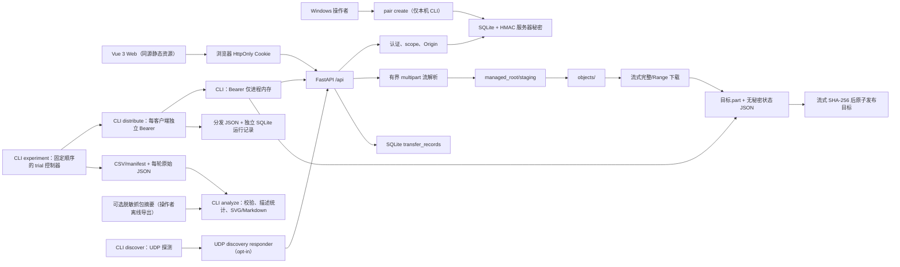

# 当前架构（T011 实验分析）

**状态**：T003 后端、T004 Vue Web、T005 单 Range/If-Range、T006 Python CLI 安全续传、T007/T008 分发控制、T009 UDP 发现、T010 实验驱动与 T011 只读分析/静态 SVG 报告均已实现并经本机自动化测试/构建验证。T004 已获得手机热点基础收发的用户确认；T009 真实广播、平板、真实 LAN 断线恢复、真实多设备分发与 G4 性能实验仍未验证。P2P 未实现。

## 组件与数据流

默认入口 python -m lan_distribution_lab 仍固定监听 127.0.0.1:8000，不修改防火墙、不自动公开 LAN/公网。serve --host {私有 IPv4} 是唯一的底层 LAN 绑定方式：拒绝 0.0.0.0/公网地址，默认将 Origin 设为同一 http://{host}:{port}。Windows 的 `scripts/start-lan.ps1` 是该显式命令的便利包装器：用户显式执行后才选择一个私有地址（优先 Windows 移动热点的 `192.168.137.1`；其余歧义则要求 `-ListenAddress`），构建静态页面并创建配对码；它不改变防火墙、NAT 或端口映射。pair create 与 serve 必须使用同一组分离的绝对 data_dir、managed_root。

## 模块边界

| 模块 | 真实职责 |
| --- | --- |
| `app.py` | HTTP 路由、认证依赖、Origin/内容类型检查、响应头和受控槽位 |
| `body.py` | 对配对 JSON 的有界 `Request.stream()` 累计读取 |
| `multipart.py` | 单文件 multipart 的有界流解析；不调用框架表单缓存 |
| `auth.py` | 配对码、令牌摘要、scope、撤销与流式分块时会话复核 |
| `storage.py` | SQLite schema、事务、状态目录和服务器秘密 |
| `files.py` | staging 写入、SHA-256、配额/磁盘检查、原子硬链接发布、对象读取和任务记录 |
| `runtime.py` | 组合服务及上传/下载 `BoundedSemaphore` 槽位 |
| `client.py` | 标准库 HTTP CLI 客户端；Bearer 内存使用、Range/If-Range 续传、状态验证、SHA-256 与原子发布、元数据预检和鉴权/槽位错误类型 |
| `distribution.py` | 控制器侧多客户端编排：顺序、普通并发与固定上限受控并发；独立凭据与输出、FIFO 排队、等待/执行计时、JSON 结果与安全错误分类 |
| `distribution_store.py` | 控制器侧独立 SQLite 分发运行记录（runs/clients），支持 T007 库原地迁移到三种策略且保留历史 |
| `experiment.py` | T010 实验控制器：验证有界配置、固定轮次/文件/策略顺序、每 trial 全新目录、及时原子导出 manifest/CSV、失败/中断状态和描述性统计；不保存凭据 |
| `analysis.py` | T011 只读 T010 数据校验、可比条件分组、描述统计/Jain 指数、静态 SVG 和 Markdown 报告；不读取 PCAP、不监听网络、不修改输入 |
| `discovery.py` | 可选的 UDP 局域网发现协议：有界 JSON 请求/响应、来源 IP 校验、request_id 回显、去重/排序/超时与限速 |
| `web/` | Vue 3 + TypeScript + Vite 源码；构建后的 web/dist 由同一 FastAPI 进程提供 |

## 已实现 API 与语义

- `GET /api/health`：公开 liveness。
- `POST /api/pairings`：4 KiB 有界 JSON 读取；浏览器 Cookie 或 CLI Bearer 会话。
- `DELETE /api/sessions/current`：首次有效撤销为 204；已撤销、过期或无效凭据再次为 401；Cookie 状态变更检查 Origin 并清理 Cookie。
- `GET /api/files`、`GET /api/files/{file_id}`：`read` 会话后才查询；无效 UUID 为 422，不存在对象为 404，不暴露磁盘路径。
- `POST /api/uploads`：`read_write` 会话；Cookie 请求检查 Origin；multipart 总请求、文件、总配额、可用磁盘和上传槽位均有限制。文件写入 staging 时分块计算 SHA-256，随后以服务端 UUID 硬链接发布到 objects，并写入 SQLite。
- `GET /api/files/{file_id}/content`：`read` 会话下的完整 `200` 或单 Range `206` 流，带 `Content-Length`、`Accept-Ranges`、强 ETag、安全 `Content-Disposition` 与 `X-Transfer-Id`。`bytes=start-end`、`start-`、`-suffixLength` 通过 seek 和剩余字节计数流式读取；不支持多范围。`If-Range` 仅精确匹配强 ETag 时允许 `206`，否则回退完整 `200`；不可满足范围为 `416` 并带总大小。
- `GET /api/transfers/{transfer_id}`：仅任务所属会话可见。`completed` 仅表示服务端读完/写完本地字节，**不表示远端客户端已经保存成功**。
- `GET /`：仅在已构建 web/dist 时提供同源 Vue 页面；页面通过 Cookie 请求既有 API，不使用 CORS、localStorage、URL token 或 QR token。
- `python -m lan_distribution_lab download`：用 Bearer 调用元数据与内容 API。它不接受 token 命令行参数；默认以无回显提示读取 token，或用 `--pair` 将无回显的配对码兑换为仅进程内 token。邻接 `.part.json` 只记录 server、file_id、ETag、大小、SHA-256 与已落盘字节；不记录 token 或文件系统路径。
- `python -m lan_distribution_lab distribute`：控制器侧多客户端分发控制；每个逻辑客户端使用独立凭据与独立输出目录，支持 sequential、parallel 与 controlled（固定并发上限，客户端数 ≤ 8），输出机器可读 JSON 结果并追加独立 SQLite 分发运行记录；不新增服务端端点。

## 分发控制（T007/T008）

`distribute` 是控制器进程，只协调多个客户端分别主动拉取同一对象；服务端仍是唯一的文件与认证权威，不新增推送、P2P 或调度端点。三种策略：

- `sequential`：逐个启动客户端，前一个下载与发布结束后才启动下一个；`--stop-on-error` 时未开始者标记 `cancelled`。
- `parallel`：以有界线程池同时启动全部客户端（上限 8），多个阻塞 HTTP 下载在网络层面真实重叠。
- `controlled`：把客户端任务按确定性 FIFO 顺序提交给固定 `max_concurrent` 个工作者的线程池；同时活跃任务数不超过该上限，任务结束后自动接纳下一个等待任务，队列长度受客户端总数（≤ 8）约束。`--max-concurrent` 只对 `controlled` 有效，必须是 1..参与客户端数且不超过安全上限；缺失或误用会在下载开始前报错。

三种策略都复用 T006 的下载路径（独立会话、强 ETag、Range/If-Range、最终 SHA-256、不覆盖已有目标），单个客户端认证失败、超时、断开或槽位不足只影响自身记录。控制器以 `_ActiveCounter` 记录观测到的最大活跃任务数；客户端排队等待、客户端执行时间和批次总耗时分别记录：`queued_at`/`wait_seconds` 为排队等待，客户端 `duration_seconds` 为执行时间，运行级 `duration_seconds` 为批次耗时，均使用 `time.monotonic()`，时间戳为 UTC。

运行记录含唯一 run_id、策略、`max_concurrent`/`observed_max_active`、文件大小/SHA-256、各客户端 task_id/状态/时间/字节/复用字节/安全错误类型，以及成功/失败/取消汇总。JSON 为 `schema_version: 2`（v1 字段语义不变，新增 `scheduling` 与客户端等待字段）。SQLite 库原地迁移：T007 旧库重建 `distribution_runs` 放宽 strategy CHECK 并保留历史行，`distribution_clients` 增加等待列；重复打开幂等，不删除数据库。凭据、Cookie、配对码与私人绝对路径不写入 JSON、SQLite 或日志。控制器运行在一台电脑上，逻辑客户端是独立会话的本机进程，不是真实远程设备。

## 可重复实验驱动（T010）

`python -m lan_distribution_lab experiment` 在一个进程启动时收集 N 个不同的 CLI Bearer 凭据（`--pair` 无回显兑换或安全 `--tokens-stdin`），以后只在进程内存中复用。每个计划单元有 UUID `trial_id`，顺序固定为 `round → file_id → strategy`，不采用未记录的随机化；每个实验也有 UUID `experiment_id`。受控策略必须提供 `1..clients` 的 `max_concurrent`，客户端不超过 8、轮次不超过 10、文件不超过 4、总 trial 不超过 100。

每一个 trial 都在新建的 `trials/trial-<序号>/` 内调用既有 `run_distribution()`；目录中只有成功返回的 `distribution-result.json` 原始记录及每个客户端全新的下载工件，因此不会把已完成缓存计为网络传输。根目录不允许预先存在或为链接，`experiments.json`、`trials.csv`、`clients.csv` 通过同目录临时文件原子替换。失败 trial、停止策略取消的未开始 trial 与 Ctrl+C 中断的当前 trial 都进入 CSV/manifest，绝不计作成功；仅成功 trial 产生原始 DistributionRun JSON。

清单记录数据格式版本、开始/更新时间、配置、环境标签、Git/Python/平台版本、trial 索引和统计。`environment_type=local_loopback` 仅描述本机 loopback；`controller_to_lan` 只描述控制器访问 LAN 服务。两者的逻辑客户端都不是物理移动设备，真实多设备无线实验只能在后续人工记录中如实标注。按策略的 `success_rate` 分母是该策略所有 trial；时间和有效载荷吞吐量的描述性统计仅使用全部客户端成功的 trial。吞吐量定义为 `成功客户端数 × 文件大小 / 批次 duration_seconds`（B/s），不是网卡/链路带宽，也不导出策略优劣结论。

## UDP 局域网发现（T009）

服务默认关闭 UDP 发现。只有显式 `serve --discover --host <私有 IPv4>` 时才启动独立 UDP responder（默认绑定 `0.0.0.0:47800`）；UDP 绑定范围与 HTTP 绑定策略分离，HTTP 仍只接受显式私有/回环地址，不因发现功能放宽。

协议为单请求/单响应的有界 UTF-8 JSON：请求含协议名、协议版本、`type=discover` 和随机 `request_id`；响应回显同一 `request_id`，并含非秘密 `instance_id`、`service_name`、`http_port`、`requires_pairing` 与兼容性 `features`。请求/响应各不超过 1 KiB，服务名与标识符有长度和字符限制；响应不含 token、Cookie、配对码、服务器密钥、数据目录、文件列表或文件内容。

客户端只接受私有或回环 IPv4 来源，并以 **UDP 源 IP + 响应中的 HTTP 端口**构造 URL（不信任正文中的任意 URL）；校验 `request_id`、协议版本与字段边界，按内联去重键去重并排序，限制响应数/数据包数与总超时，丢弃非法或超大 UDP 包而不终止发现。服务端只响应合法请求，并做每来源速率限制与来源数量上限，避免反射放大和内存/CPU 滥用。UDP 发现只寻找候选服务，不认证、不下载、不执行文件，也不授予 read/read_write 权限。

## 安全与资源边界

默认值：单文件 64 MiB、multipart 总请求 64 MiB + 128 KiB、受控对象总额 1 GiB、保留 64 MiB 空闲空间、同时上传 2、下载 8。超过限制返回统一安全错误并清理 staging；`ENOSPC`/配额不足返回 507。上传和下载每个分块复核会话是否撤销或过期。

客户端展示名从不决定对象路径，拒绝路径分隔符、Windows 保留字符、控制字符、`.` 与 `..`。对象/目录操作以服务端 UUID 并做普通文件、符号链接/reparse-point 检查；本机受限环境未能创建符号链接，因此真实 Windows 链接/reparse-point 竞态仍是未验证风险。

CLI 每次开始先读取文件元数据，再只接受与之完全匹配的强 ETag、`Content-Length`、`Content-Range` 和最终 SHA-256。已有 `.part` 时请求 `Range: bytes=<offset>-` 与 `If-Range`；`200`、`416` 或本地状态/版本不一致会隔离旧工件并有限地从头开始，错误 `206` 不写入任何新字节。每块先 `fsync` `.part`，再原子替换状态 JSON；最终以同目录硬链接创建目标名，避免覆盖并发出现的用户文件。

## 明确未实现

- 动态并发窗口、自适应速率控制、优先级调度（T008 固定并发范围外）
- P2P 文件块交换、公网/跨 VLAN/跨广播域自动发现与部署
- 浏览器原生 UDP 发现与二维码连接（T009 未实现，手动 URL 可用）
- 上传幂等键、上传断点续传与浏览器后台续传
- HTTPS、真实手机/平板的多设备分发、真实 LAN 性能/可靠性实验

HTTP 没有 TLS：短时令牌、Cookie 和文件内容仍可能被同网段窃听或篡改。完整契约见 [API_CONTRACT.md](API_CONTRACT.md)，风险见 [THREAT_MODEL.md](THREAT_MODEL.md)。
