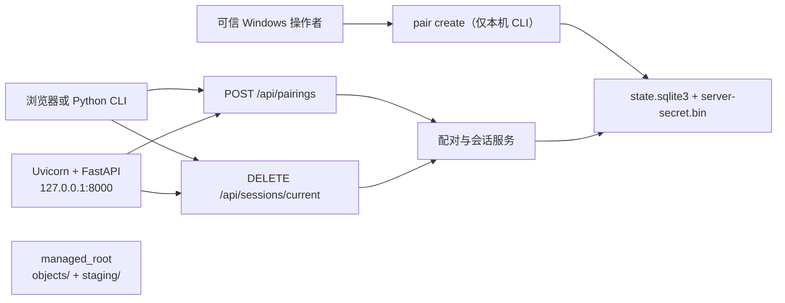

# 当前架构（T001、T002 设计、T003-A 实现）

**状态**：T003-A 已实现本机配对码、会话授权、SQLite 状态和受控目录基础，并通过本地自动化测试。文件列表、上传、下载、Range、传输记录、前端与设备发现均未实现；`objects/`、`staging/` 目前不会承载文件业务。

## 运行组成与安全边界



`python -m lan_distribution_lab` 仍等同于 `serve`，固定绑定 `127.0.0.1:8000`。应用不修改 Windows 防火墙、不默认监听局域网或公网。T003-A 的浏览器 Origin 默认值为 `http://127.0.0.1:8000`；需要显式 `--origin` 才能改变，且这不改变监听地址。

## 模块边界

| 路径 | 职责 | 状态 |
| --- | --- | --- |
| `app.py` | HTTP 健康、配对、撤销路由；请求大小/Origin 与统一错误适配 | 已实现 |
| `__main__.py` | 标准库 argparse；`serve` 与仅本机的 `pair create` | 已实现 |
| `config.py` | 本地状态目录、受控根、TTL、限速和 Origin 配置 | 已实现 |
| `storage.py` | SQLite 初始化、HMAC 服务器秘密、事务、`objects`/`staging` 布局 | 已实现 |
| `auth.py` | 配对码兑换、令牌摘要认证、scope、撤销和 FastAPI 依赖 | 已实现 |
| `models.py` / `errors.py` / `runtime.py` | 小型领域模型、统一安全错误、惰性运行时 | 已实现 |
| `tests/test_auth_storage.py` | T003-A 临时目录、可控时间、并发与 HTTP 安全测试 | 已实现 |
| 文件对象/传输服务、文件 HTTP API、Range、CLI 续传、Web UI、UDP | 后续任务 | 未实现 |

## 已实现接口

- `GET /api/health`：公开 liveness；严格返回 `{"status":"ok","service":"lan-distribution-lab"}`。
- `POST /api/pairings`：4 KiB JSON 上限；短时一次性六位码原子兑换会话。CLI 响应一次性含 Bearer token；浏览器响应不含 token，并设置 HttpOnly、SameSite=Strict、`Path=/api` Cookie。浏览器请求的 Origin 必须精确匹配配置。
- `DELETE /api/sessions/current`：Bearer 或 Cookie 认证后撤销会话。Cookie 认证还需精确 Origin；成功返回 204 并清理 Cookie。撤销/过期的凭据在之后的认证中返回 401。

错误均为 `{"error":{"code":"...","message":"..."}}`，且不回显配对码、访问令牌或本地绝对路径。

## 持久化与目录布局

操作者配置的 `data_dir` 与 `managed_root` 必须是不同的绝对路径，且不能相互嵌套。默认状态目录为 Windows `%LOCALAPPDATA%\LANDistributionLab\state`；`managed_root` 默认为它的同级 `managed` 目录。`--data-dir`/`--managed-root` 或相应环境变量可覆盖该默认值。

```text
data_dir/
  state.sqlite3             # pairing_codes、sessions、pairing_failures、file_metadata 基础表
  server-secret.bin         # 32 字节本机 HMAC 秘密，不提交 Git
managed_root/
  objects/                  # 已创建；T003-A 不写入文件
  staging/                  # 已创建；T003-A 不写入文件
```

SQLite 的 `BEGIN IMMEDIATE` 用于配对码兑换，确保并发请求只有一个能消耗同一代码。配对码和访问令牌的秘密部分均只以 HMAC-SHA-256 摘要落库；会话记录保存 UUID、scope、创建/绝对过期/撤销时间和可选设备标签。`file_metadata` 是后续外键/数据迁移的空基础，当前没有文件业务操作。

## 已知限制和下一步

- HTTP 没有 TLS：Cookie/Bearer/码可能被同网段窃听；本实现不宣称链路机密性或抗中间人。
- 未做真实手机、平板、LAN、Windows ACL 或 reparse-point 测试。
- T003-B 应只在此基础上实现受控上传、下载、SHA-256、资源限额、文件元数据/任务记录及相应测试；不得改变 T003-A 的本地默认监听和会话边界。

完整 API 设计见 [API_CONTRACT.md](API_CONTRACT.md)，威胁边界见 [THREAT_MODEL.md](THREAT_MODEL.md)，测试分期见 [TEST_PLAN.md](TEST_PLAN.md)。
