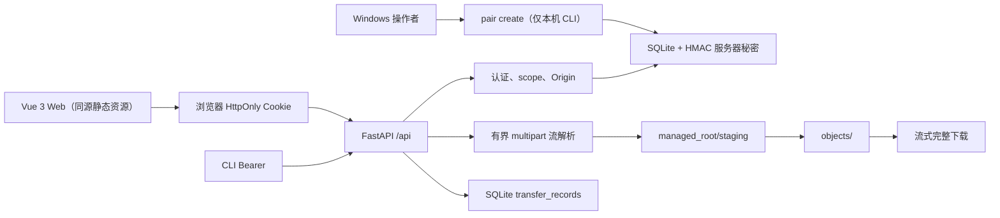

# 当前架构（T004 Web 实现）

**状态**：T003 后端和 T004 Vue Web 界面均已实现并经本机自动化测试/构建验证。T004 的真实手机、平板与家庭 Wi-Fi 互通仍为 NOT_RUN；Range、CLI 续传、UDP 与真实设备实验未实现。

## 组件与数据流

默认入口 python -m lan_distribution_lab 仍固定监听 127.0.0.1:8000，不修改防火墙、不自动公开 LAN/公网。serve --host {私有 IPv4} 是唯一的底层 LAN 绑定方式：拒绝 0.0.0.0/公网地址，默认将 Origin 设为同一 http://{host}:{port}。Windows 的 `scripts/start-lan.ps1` 是该显式命令的便利包装器：用户显式执行后才选择一个私有地址（优先 Windows 移动热点的 `192.168.137.1`；其余歧义则要求 `-ListenAddress`），构建静态页面并创建配对码；它不改变防火墙、NAT 或端口映射。pair create 与 serve 必须使用同一组分离的绝对 data_dir、managed_root。

## 模块边界

| 模块 | 真实职责 |
| --- | --- |
| `app.py` | HTTP 路由、认证依赖、Origin/内容类型检查、响应头和受控槽位 |
| `body.py` | 对配对 JSON 的有界 `Request.stream()` 累计读取 |
| `multipart.py` | 单文件 multipart 的有界流解析；不调用框架表单缓存 |
| `auth.py` | 配对码、令牌摘要、scope、撤销与流式分块时会话复核 |
| `storage.py` | SQLite schema、事务、状态目录和服务器秘密 |
| `files.py` | staging 写入、SHA-256、配额/磁盘检查、原子硬链接发布、对象读取和任务记录 |
| `runtime.py` | 组合服务及上传/下载 `BoundedSemaphore` 槽位 |
| `web/` | Vue 3 + TypeScript + Vite 源码；构建后的 web/dist 由同一 FastAPI 进程提供 |

## 已实现 API 与语义

- `GET /api/health`：公开 liveness。
- `POST /api/pairings`：4 KiB 有界 JSON 读取；浏览器 Cookie 或 CLI Bearer 会话。
- `DELETE /api/sessions/current`：首次有效撤销为 204；已撤销、过期或无效凭据再次为 401；Cookie 状态变更检查 Origin 并清理 Cookie。
- `GET /api/files`、`GET /api/files/{file_id}`：`read` 会话后才查询；无效 UUID 为 422，不存在对象为 404，不暴露磁盘路径。
- `POST /api/uploads`：`read_write` 会话；Cookie 请求检查 Origin；multipart 总请求、文件、总配额、可用磁盘和上传槽位均有限制。文件写入 staging 时分块计算 SHA-256，随后以服务端 UUID 硬链接发布到 objects，并写入 SQLite。
- `GET /api/files/{file_id}/content`：`read` 会话下的完整 200 流，带 `Content-Length`、强 ETag、安全 `Content-Disposition` 与 `X-Transfer-Id`；不支持 Range。
- `GET /api/transfers/{transfer_id}`：仅任务所属会话可见。`completed` 仅表示服务端读完/写完本地字节，**不表示远端客户端已经保存成功**。
- `GET /`：仅在已构建 web/dist 时提供同源 Vue 页面；页面通过 Cookie 请求既有 API，不使用 CORS、localStorage、URL token 或 QR token。

## 安全与资源边界

默认值：单文件 64 MiB、multipart 总请求 64 MiB + 128 KiB、受控对象总额 1 GiB、保留 64 MiB 空闲空间、同时上传 2、下载 8。超过限制返回统一安全错误并清理 staging；`ENOSPC`/配额不足返回 507。上传和下载每个分块复核会话是否撤销或过期。

客户端展示名从不决定对象路径，拒绝路径分隔符、Windows 保留字符、控制字符、`.` 与 `..`。对象/目录操作以服务端 UUID 并做普通文件、符号链接/reparse-point 检查；本机受限环境未能创建符号链接，因此真实 Windows 链接/reparse-point 竞态仍是未验证风险。

## 明确未实现

- `Range` / `If-Range` / 206（T005）
- 上传 `Idempotency-Key` 与上传断点续传
- Python CLI 续传、UDP 发现、调度与公网部署
- HTTPS、真实手机/平板、真实 LAN 性能/可靠性实验

HTTP 没有 TLS：短时令牌、Cookie 和文件内容仍可能被同网段窃听或篡改。完整契约见 [API_CONTRACT.md](API_CONTRACT.md)，风险见 [THREAT_MODEL.md](THREAT_MODEL.md)。
