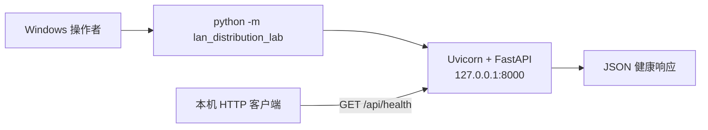
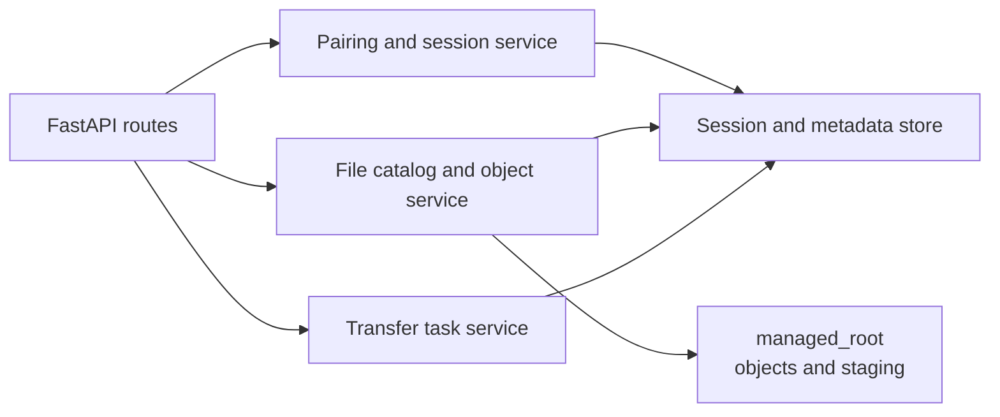

# 当前架构（T001 实现 + T002 设计）

**状态**：T001 最小服务基线已实现；T002 已完成文件 API、安全与测试设计。只有健康检查已实现；文件传输、存储、认证、数据库、设备发现、CLI 续传、前端 UI 与调度仍未实现。

## 运行组成与边界



服务入口为 `src/lan_distribution_lab/__main__.py`，固定使用 `127.0.0.1:8000`。它不会默认监听局域网接口、开放公网端口或修改 Windows 防火墙。显式 LAN 模式是后续任务的受控设计项，不属于 T001。

## 模块边界

| 路径 | 当前职责 | 状态 |
| --- | --- | --- |
| `src/lan_distribution_lab/app.py` | FastAPI 应用与 HTTP 路由 | 已实现 |
| `src/lan_distribution_lab/__main__.py` | 本地安全默认值的 Uvicorn 启动入口 | 已实现 |
| `tests/test_health.py` | 健康接口的本地 HTTP 集成测试 | 已实现 |
| 传输、存储、认证、调度、发现、Web UI | 后续按任务拆分 | 未实现（T002 已设计文件/会话边界） |

## 已实现接口契约

### `GET /api/health`

- 用途：公开、无敏感信息的进程/HTTP 服务存活检查。
- 成功响应：`200 OK`，`application/json`，响应体严格为：

```json
{"status":"ok","service":"lan-distribution-lab"}
```

- 错误边界：当前路由仅接受 GET；例如 `POST /api/health` 由 FastAPI 返回 `405 Method Not Allowed`。不存在的路径由框架返回 `404`。
- 不代表：文件共享可用、授权有效、数据库可用或局域网可达；这些能力在 T001 尚未实现，不能从健康结果推断。

## 启动与依赖

项目使用 `pyproject.toml`：直接运行/开发依赖均精确固定；`requirements.lock` 约束已解析的传递依赖。Python 支持范围为 3.12 至 3.13。Windows PowerShell 的实际命令见 [README](../README.md)。CI 使用 Python 3.12，在不需要密钥、外部业务服务或数据库的条件下运行同一 pytest 命令。T001 本机以 Python 3.13 实测 `pytest` 为 2 通过（含 1 条上游依赖弃用警告），并以实际本机 socket 请求验证了健康响应；PR #1 的 GitHub Actions 已在 Python 3.12 上通过。

## T002 推荐资源架构（设计中）

T003 应在现有 FastAPI HTTP 适配层之外，增加彼此独立的会话授权、文件对象存储、元数据和传输任务模块；不在路由函数中直接组合客户端路径或长期保存明文凭据。



- **HTTP 适配层**：验证请求形态、返回统一错误、流式传输；只接收 UUID 和展示名，不接收服务器路径。
- **会话服务**：短时一次性配对码换取限时 `read` / `read_write` 会话；浏览器使用 HttpOnly Cookie，CLI 使用 Bearer token，服务端只保存摘要。
- **对象服务**：以服务器生成的 `file_id` 和 `storage_key` 管理不可变快照；上传先进入私有 staging，完成 SHA-256、配额检查后原子发布。
- **元数据与任务服务**：维护 `FileRecord`、`SessionRecord` 和 `TransferRecord` 的最小字段；T003 是否立即使用 SQLite 尚未决定，不能在实现前假定已有数据库。

完整 HTTP 契约、文件模型及 Range/ETag 扩展路径见 [API_CONTRACT.md](API_CONTRACT.md)；信任边界与残余风险见 [THREAT_MODEL.md](THREAT_MODEL.md)；分阶段测试见 [TEST_PLAN.md](TEST_PLAN.md)。
