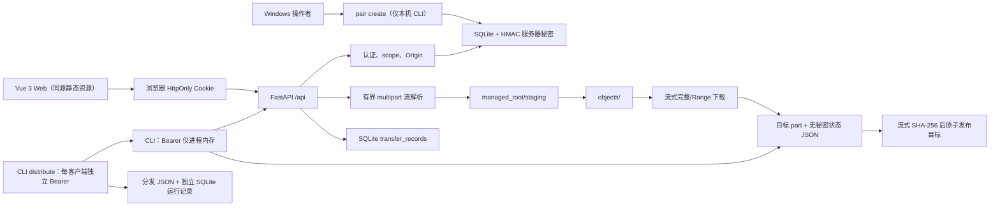

# 当前架构（T007 多客户端分发）

**状态**：T003 后端、T004 Vue Web、T005 单 Range/If-Range、T006 Python CLI 安全续传（已合并）与 T007 多客户端分发控制均已实现并经本机自动化测试/构建验证。T004 已获得手机热点基础收发的用户确认；平板、真实 LAN 断线恢复、真实多设备分发与性能实验仍未验证。UDP、P2P 与 T008 调度未实现。

## 组件与数据流

默认入口 python -m lan_distribution_lab 仍固定监听 127.0.0.1:8000，不修改防火墙、不自动公开 LAN/公网。serve --host {私有 IPv4} 是唯一的底层 LAN 绑定方式：拒绝 0.0.0.0/公网地址，默认将 Origin 设为同一 http://{host}:{port}。Windows 的 `scripts/start-lan.ps1` 是该显式命令的便利包装器：用户显式执行后才选择一个私有地址（优先 Windows 移动热点的 `192.168.137.1`；其余歧义则要求 `-ListenAddress`），构建静态页面并创建配对码；它不改变防火墙、NAT 或端口映射。pair create 与 serve 必须使用同一组分离的绝对 data_dir、managed_root。

## 模块边界

| 模块 | 真实职责 |
| --- | --- |
| `app.py` | HTTP 路由、认证依赖、Origin/内容类型检查、响应头和受控槽位 |
| `body.py` | 对配对 JSON 的有界 `Request.stream()` 累计读取 |
| `multipart.py` | 单文件 multipart 的有界流解析；不调用框架表单缓存 |
| `auth.py` | 配对码、令牌摘要、scope、撤销与流式分块时会话复核 |
| `storage.py` | SQLite schema、事务、状态目录和服务器秘密 |
| `files.py` | staging 写入、SHA-256、配额/磁盘检查、原子硬链接发布、对象读取和任务记录 |
| `runtime.py` | 组合服务及上传/下载 `BoundedSemaphore` 槽位 |
| `client.py` | 标准库 HTTP CLI 客户端；Bearer 内存使用、Range/If-Range 续传、状态验证、SHA-256 与原子发布、元数据预检和鉴权/槽位错误类型 |
| `distribution.py` | 控制器侧多客户端编排：独立凭据与输出、sequential/parallel、单调时钟计时、JSON 结果与安全错误分类 |
| `distribution_store.py` | 控制器侧独立 SQLite 分发运行记录（runs/clients），不触碰服务端状态 |
| `web/` | Vue 3 + TypeScript + Vite 源码；构建后的 web/dist 由同一 FastAPI 进程提供 |

## 已实现 API 与语义

- `GET /api/health`：公开 liveness。
- `POST /api/pairings`：4 KiB 有界 JSON 读取；浏览器 Cookie 或 CLI Bearer 会话。
- `DELETE /api/sessions/current`：首次有效撤销为 204；已撤销、过期或无效凭据再次为 401；Cookie 状态变更检查 Origin 并清理 Cookie。
- `GET /api/files`、`GET /api/files/{file_id}`：`read` 会话后才查询；无效 UUID 为 422，不存在对象为 404，不暴露磁盘路径。
- `POST /api/uploads`：`read_write` 会话；Cookie 请求检查 Origin；multipart 总请求、文件、总配额、可用磁盘和上传槽位均有限制。文件写入 staging 时分块计算 SHA-256，随后以服务端 UUID 硬链接发布到 objects，并写入 SQLite。
- `GET /api/files/{file_id}/content`：`read` 会话下的完整 `200` 或单 Range `206` 流，带 `Content-Length`、`Accept-Ranges`、强 ETag、安全 `Content-Disposition` 与 `X-Transfer-Id`。`bytes=start-end`、`start-`、`-suffixLength` 通过 seek 和剩余字节计数流式读取；不支持多范围。`If-Range` 仅精确匹配强 ETag 时允许 `206`，否则回退完整 `200`；不可满足范围为 `416` 并带总大小。
- `GET /api/transfers/{transfer_id}`：仅任务所属会话可见。`completed` 仅表示服务端读完/写完本地字节，**不表示远端客户端已经保存成功**。
- `GET /`：仅在已构建 web/dist 时提供同源 Vue 页面；页面通过 Cookie 请求既有 API，不使用 CORS、localStorage、URL token 或 QR token。
- `python -m lan_distribution_lab download`：用 Bearer 调用元数据与内容 API。它不接受 token 命令行参数；默认以无回显提示读取 token，或用 `--pair` 将无回显的配对码兑换为仅进程内 token。邻接 `.part.json` 只记录 server、file_id、ETag、大小、SHA-256 与已落盘字节；不记录 token 或文件系统路径。
- `python -m lan_distribution_lab distribute`：控制器侧多客户端分发控制；每个逻辑客户端使用独立凭据与独立输出目录，支持 sequential 与 parallel（客户端数 ≤ 8），输出机器可读 JSON 结果并追加独立 SQLite 分发运行记录；不新增服务端端点。

## 分发控制（T007）

`distribute` 是控制器进程，只协调多个客户端分别主动拉取同一对象；服务端仍是唯一的文件与认证权威，不新增推送、P2P 或调度端点。`sequential` 逐个启动客户端，前一个下载与发布结束后才启动下一个；`parallel` 在一次运行内以有界线程池同时启动所有客户端（上限 8），多个阻塞 HTTP 下载在网络层面真实重叠，测试以服务端同时在途请求数验证，而不是以耗时推断策略快慢。每个客户端使用自己的 Bearer 会话与 `client-<n>/<output-name>`；目标已存在且内容不同即失败不覆盖；单个客户端认证失败、超时、断开或槽位不足只影响自身记录。

运行记录含唯一 run_id、策略、文件大小/SHA-256、各客户端 task_id/状态/UTC 起止时间/单调耗时/字节/复用字节/安全错误类型，以及成功/失败/取消汇总。凭据、Cookie、配对码与私人绝对路径不写入 JSON、SQLite 或日志。控制器运行在一台电脑上，逻辑客户端是独立会话的本机进程，不是真实远程设备。

## 安全与资源边界

默认值：单文件 64 MiB、multipart 总请求 64 MiB + 128 KiB、受控对象总额 1 GiB、保留 64 MiB 空闲空间、同时上传 2、下载 8。超过限制返回统一安全错误并清理 staging；`ENOSPC`/配额不足返回 507。上传和下载每个分块复核会话是否撤销或过期。

客户端展示名从不决定对象路径，拒绝路径分隔符、Windows 保留字符、控制字符、`.` 与 `..`。对象/目录操作以服务端 UUID 并做普通文件、符号链接/reparse-point 检查；本机受限环境未能创建符号链接，因此真实 Windows 链接/reparse-point 竞态仍是未验证风险。

CLI 每次开始先读取文件元数据，再只接受与之完全匹配的强 ETag、`Content-Length`、`Content-Range` 和最终 SHA-256。已有 `.part` 时请求 `Range: bytes=<offset>-` 与 `If-Range`；`200`、`416` 或本地状态/版本不一致会隔离旧工件并有限地从头开始，错误 `206` 不写入任何新字节。每块先 `fsync` `.part`，再原子替换状态 JSON；最终以同目录硬链接创建目标名，避免覆盖并发出现的用户文件。

## 明确未实现

- T008 动态调度、优先级、速率控制与受控并发策略
- T009 UDP 发现、P2P 与公网部署
- 上传幂等键、上传断点续传与浏览器后台续传
- HTTPS、真实手机/平板的多设备分发、真实 LAN 性能/可靠性实验

HTTP 没有 TLS：短时令牌、Cookie 和文件内容仍可能被同网段窃听或篡改。完整契约见 [API_CONTRACT.md](API_CONTRACT.md)，风险见 [THREAT_MODEL.md](THREAT_MODEL.md)。
