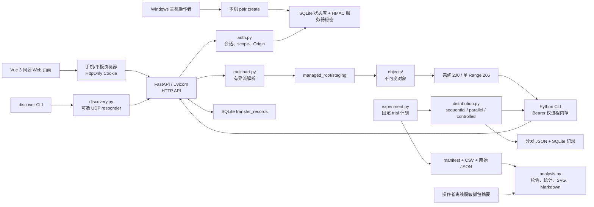

# 《基于 TCP/HTTP 与 UDP 服务发现的局域网可靠文件传输与多客户端协同分发系统设计与实现》

| 项目 | 内容 |
| --- | --- |
| 课程 | 网络通信相关课程（待填写课程全称） |
| 学生 | （待填写姓名、学号、班级） |
| 指导教师 | （待填写） |
| 项目仓库 | <https://github.com/cppppercy/lan-distribution-lab> |
| 报告对应代码基线 | `00c3fbe376fb9ba305b4e225cbb06571a83f83ad` |
| 报告日期 | 2026-11-11 |

## 摘要

局域网内的文件收发看似简单，但一个可用于课程实验的系统还需要处理授权、文件完整性、中断恢复、并发访问、实验可追溯性以及真实网络环境的不确定性。本项目以一台 Windows 主机为中心节点，采用 HTTP/1.1 over TCP 承担文件上传与下载，并以 FastAPI 提供服务端接口、Vue 3 提供同源浏览器页面、Python CLI 提供可验证的断点续传与批量分发能力。已实现的关键机制包括：短时一次性配对码、浏览器 Cookie 与 CLI Bearer 会话、受控目录中的流式上传、SHA-256 校验、强 ETag、单一 HTTP Range 与 If-Range、UDP 候选服务发现，以及顺序、普通并发和固定上限受控并发三种控制器侧分发策略。

项目还实现了实验驱动与只读分析工具：前者以固定 `round → file_id → strategy` 顺序导出 JSON/CSV 原始记录，后者校验原始数据一致性后生成描述统计、SVG 与 Markdown 报告。它们用于保证后续实验可复现，而不是替代真实无线网络测试。代码基线 `00c3fbe…` 的 GitHub Actions Windows CI 已完成，pytest 为 173 passed、1 warning；Vue 前端测试为 2 passed，生产构建成功。另有一次用户在 Windows 移动热点下完成电脑与手机的基础双向文件收发确认。平板验证、文件 SHA-256 的人工对照、真实 WLAN 断线恢复、多设备并发和性能数据、Wireshark 抓包均尚未执行，因此本报告不对吞吐量、策略优劣或无线网络性能作数值结论。

**关键词：** 局域网文件传输；HTTP Range；断点续传；SHA-256；UDP 服务发现；受控并发

## 第一章 实验背景与研究目的

### 1.1 问题背景

在家庭 Wi-Fi、移动热点或实验室局域网中，电脑、手机和平板之间经常需要交换课程资料、照片或实验文件。单次文件复制可以依赖即时通信软件或云盘，但这些工具往往无法展示协议过程，也不利于控制文件版本、记录失败、观察并发行为或重复实验。课程项目需要把抽象的网络通信知识落实为可运行、可测量并且能说明边界的应用，而不只是做一个“能上传下载”的页面。

普通文件传输至少面临四类问题。其一，网络连接会中断，客户端若直接重新下载，既浪费流量，也可能错误地把不同版本的字节拼接在一起。其二，浏览器和命令行客户端的凭据使用方式不同，局域网中的其他设备不应因为处于同一 Wi-Fi 就自动获得访问权限。其三，多客户端同时获取同一文件时，需要区分“全部同时执行”和“限制同时执行数量”，并记录每个任务的状态。其四，自动化回归测试可以证明程序在受控条件下的正确性，却不能替代手机、平板和真实无线链路上的性能实验。

本项目采用中心服务器架构：Windows 主机保存受控文件对象并提供 HTTP 服务，浏览器和 Python CLI 均主动向它请求数据。这里的“协同分发”是中心服务器协调多个接收端分别下载同一对象，不是客户端之间互传文件块的 P2P 系统。该选择使访问控制、不可变文件版本和实验记录集中在一个可审查的位置，也使后续的性能实验可以明确服务端、文件、客户端数和并发上限等控制变量。

### 1.2 实验目标与范围

本项目的工程目标如下：

1. 在默认不暴露局域网的前提下，为授权浏览器提供文件列表、上传和下载能力。
2. 为 CLI 客户端提供基于 Range、If-Range、强 ETag 与 SHA-256 的安全恢复下载路径。
3. 在控制器侧实现 sequential、parallel、controlled 三种多客户端分发方式，并保留任务级记录。
4. 使用有界、可追溯的数据导出和分析流程，支持后续真实网络实验。
5. 使用 UDP 发现减少桌面客户端手动输入地址的成本，但不把发现结果当作授权或身份认证。

本报告讨论的是已实现功能、自动化证据和可执行的真实实验方案。HTTPS、上传断点续传、动态并发控制、P2P、公网部署、浏览器原生 UDP、二维码连接以及真实 G4 性能数据均不属于已经完成的结论。

## 第二章 相关网络通信理论

### 2.1 TCP 的可靠字节流及其在本项目中的位置

TCP 向应用提供面向连接的有序字节流。客户端通过三次握手建立连接，利用序列号、确认号和重传等机制处理报文丢失或乱序；流量控制避免接收端缓存被过快的发送端淹没，拥塞控制则根据网络反馈调节发送行为。RFC 9293 是 TCP 的现行标准性规范。[RFC 9293](https://www.rfc-editor.org/rfc/rfc9293.html)

本项目没有自行实现 TCP 的握手、确认、重传、拥塞控制或可靠传输算法，而是运行在操作系统 TCP 栈之上。FastAPI/Uvicorn 提供 HTTP 服务，浏览器和 Python 标准库 HTTP 客户端通过 TCP 连接交换 HTTP 报文。TCP 的可靠字节流保证“一个连接内的字节交付语义”，但不自动回答“客户端得到的是不是同一文件版本”“下载完成后文件是否完整”或“应用应如何在一次连接失败后恢复”；这些是项目在 HTTP 与文件层继续处理的问题。

例如，一次 TCP 重传只说明传输层对某些报文段做了恢复；它不等于应用层已经进行了断点续传。反过来，CLI 重新发起一次携带 Range 的 HTTP 请求，也不意味着此前一定发生了 TCP 重传。报告中的协议层次区分对后续抓包解释尤其重要。

### 2.2 HTTP/1.1 文件传输

HTTP 是无状态的应用层请求—响应协议。客户端用 `GET` 获取文件或元数据，用 `POST` 上传 multipart 文件；服务端通过状态码和响应头表达处理结果。RFC 9110 定义了 HTTP 语义、状态码、条件请求和范围请求等通用规则。[RFC 9110](https://www.rfc-editor.org/rfc/rfc9110.html)

本项目的文件下载接口为 `GET /api/files/{file_id}/content`。无 Range 头时，服务端返回完整 `200` 响应；文件由受控对象路径分块读取，不把整个大文件装入内存。上传接口 `POST /api/uploads` 采用有界 multipart 流解析，接收过程中统计实际字节数并同时计算 SHA-256。HTTP 状态码还承担应用错误表达：例如无会话返回 `401`，权限范围不足返回 `403`，请求过大返回 `413`，存储空间或配额不足返回 `507`。

HTTP/1.1 位于 TCP 之上，因此其单个响应字节仍由 TCP 传输；但 HTTP 的资源 URI、状态码、ETag 和条件请求使应用可以表达“正在访问哪个不可变文件对象”以及“是否可以安全继续旧的局部文件”。

### 2.3 HTTP Range、If-Range 与文件版本保护

对于大小为 $S$ 字节、从 0 开始编号的对象，`Range: bytes=a-b` 表示请求闭区间 $[a,b]$；`Range: bytes=a-` 表示从 $a$ 到末尾；`Range: bytes=-k` 表示最后 $k$ 个字节。本项目只支持单一范围，避免多范围 MIME 响应带来的额外解析复杂度。

服务端的实际语义如下。

| 场景 | 响应 | 关键含义 |
| --- | --- | --- |
| 未携带 Range | `200` | 返回完整对象 |
| 合法且可满足的单 Range | `206` | 返回指定字节，并携带 `Content-Range`、范围长度、`Accept-Ranges` 和强 ETag |
| 范围不可满足 | `416` | 返回 `Content-Range: bytes */S` |
| 多范围或非法语法 | `400` | 明确拒绝，不返回不确定的字节集合 |
| If-Range 不等于当前强 ETag | `200` | 忽略旧 Range，返回完整当前对象，禁止错误拼接 |

本项目的 ETag 是与文件 SHA-256 对应的强版本标识。CLI 若已有 `.part` 文件，会读取邻接状态文件中的对象大小、ETag、SHA-256 和已落盘偏移量 $o$，发送 `Range: bytes=o-` 与 `If-Range: <etag>`。收到严格匹配的 `206` 后才追加；收到完整 `200`、`416`、错误的 `Content-Range` 或 ETag 时，旧工件被隔离并从头下载，而不是继续拼接。最终仍要流式计算 SHA-256；只有大小和哈希都正确，才以原子方式发布最终目标文件。

这种机制解决的是**应用层版本一致性和恢复**，而非重复实现 TCP。它特别适用于“连接中断后服务器对象可能已经替换”的情况：即使文件大小未变，ETag 不匹配也会阻止错误续传。

### 2.4 UDP 服务发现

UDP 面向数据报，提供较少的协议机制，交付、顺序和去重均不由 UDP 保证；需要有序可靠字节流的应用应使用 TCP。[RFC 768](https://www.rfc-editor.org/rfc/rfc768.html) 因此，本项目仅把 UDP 用于低负载的候选服务发现，而不传送文件内容。

当操作者显式使用 `serve --discover --host <私有 IPv4>` 时，独立的 UDP responder 才会启动。发现请求和响应都是不超过 1 KiB 的 UTF-8 JSON：请求含协议名、版本、`type=discover` 和随机 `request_id`；响应回显该 `request_id`，并包含非秘密的实例标识、服务名、HTTP 端口、`requires_pairing` 和功能字段。客户端仅接受私有或回环 IPv4 来源，使用**UDP 源 IP 加响应中的 HTTP 端口**构造候选 URL，而不信任正文中的 URL；不匹配的 request_id、畸形/超大响应和不可信来源会被丢弃。

UDP 广播的范围受限于当前广播域，校园 Wi-Fi 的客户端隔离、跨 VLAN、多个网卡和 Windows 防火墙均可能使发现失败。因此发现失败时仍可手动输入服务器 URL。更重要的是，UDP 响应不携带 Cookie、Bearer token、配对码、文件信息或目录路径；发现成功只表示“存在一个候选地址”，设备仍必须配对。

### 2.5 文件完整性与访问控制

Python 的 `hashlib.sha256()` 可按块调用 `update()`，最终得到完整字节序列的摘要。[Python hashlib 文档](https://docs.python.org/3/library/hashlib.html) 服务端在上传时对 staging 文件流式计算 SHA-256，并把哈希、大小和 ETag 与不可变对象元数据一同保存。CLI 下载结束后再次计算本地文件的 SHA-256。哈希校验可以发现最终内容不一致，但不提供 HTTP 链路加密，也不能单独阻止实时中间人攻击。

授权采用“短时一次性六码配对码换限时会话”。Windows 主机操作员只能在本机命令行创建配对码，选择 `read` 或 `read_write` 权限；配对码默认十分钟过期且只能兑换一次。浏览器兑换成功后使用 `HttpOnly; SameSite=Strict` Cookie，CLI 则在响应体中一次取得 256-bit Bearer token。服务端仅保存令牌摘要，绝不把令牌放在 URL、前端存储、示例截图或日志中。会话绝对有效期为八小时，支持撤销；写操作还要求 Cookie 请求的 Origin 精确匹配服务 Origin。

当前实现主要使用 HTTP，未提供 TLS。短时令牌、Origin 检查和权限范围能降低未授权访问与常见跨站请求的风险，但不能抵御同一局域网内的窃听、恶意接入点或主动中间人。

## 第三章 系统需求与总体设计

### 3.1 需求映射

系统以“默认安全、文件版本可验证、实验结果可追溯”为主线。基础需求包括默认 localhost 监听、授权后的文件收发、受控磁盘路径、流式处理和统一错误。可靠性需求包括单 Range、If-Range、CLI 恢复和哈希验证。扩展需求包括控制器侧多客户端调度、UDP 候选发现以及实验数据导出和只读分析。

这些需求对应的实现并非全部拥有真实设备证据。特别是移动浏览器后台恢复、真实多设备并发、UDP 广播和性能比较仍需独立人工验证。项目不把本机逻辑客户端解释为手机、平板或真实无线链路。

### 3.2 总体架构



图中的模块均对应仓库中的实际文件。`app.py` 负责 HTTP 路由与响应；`auth.py`、`storage.py`、`files.py`、`runtime.py` 分别承担认证、SQLite 状态、文件对象和运行期并发槽位；`client.py` 是恢复下载客户端；`distribution.py`、`experiment.py`、`analysis.py` 分别负责分发、实验驱动和只读分析；`discovery.py` 负责 UDP 协议。构建后的 `web/dist` 仅在存在时由同一 FastAPI 进程提供，从而让浏览器页面与 API 同源。

### 3.3 关键数据流

| 流程 | 主要步骤 | 一致性或安全要点 |
| --- | --- | --- |
| 浏览器配对与上传 | 本机生成码 → 浏览器提交码 → Cookie 会话 → 有界 multipart → staging → SHA-256 → 原子发布 | 配对码一次性；上传需 `read_write`；文件名不决定路径；失败清理 staging |
| 授权下载 | `read` 会话 → 元数据/内容 GET → 服务端分块读取 → 浏览器原生下载 | 服务端已发送完响应不等于浏览器已经保存成功 |
| CLI 恢复下载 | 读取 `.part.json` → 元数据预检 → Range + If-Range → 分块 fsync → 最终 SHA-256 → 原子发布 | 版本或响应异常时隔离旧 `.part`，禁止错误追加 |
| UDP 后连接 | UDP 请求/响应 → 生成候选 URL → 用户配对 → 正常 HTTP 操作 | 发现不携带凭据，不授予权限，失败可手动 URL 回退 |
| 多客户端分发 | 每个逻辑客户端独立凭据和输出 → 策略调度 → 每客户端记录 → 汇总 JSON/SQLite | 控制器侧调度，不新增服务端调度协议，不等同真实多设备 |
| 实验与分析 | 固定计划 → 新 trial 目录 → manifest/CSV/原始 JSON → 只读一致性校验 → SVG/Markdown | 失败/取消保留；不合并不可比条件；不读取 PCAP |

## 第四章 关键功能设计与实现

### 4.1 服务端与 Web 页面

`src/lan_distribution_lab/app.py` 中的 `create_app()` 组合健康接口、配对、会话撤销、文件列表、元数据、上传、下载和传输任务查询。默认入口 `python -m lan_distribution_lab` 固定监听 `127.0.0.1:8000`；只有 `serve --host <私有 IPv4>` 才会监听指定局域网地址，且实现拒绝 `0.0.0.0`、公网地址与主机名。Windows `scripts/start-lan.ps1` 是显式 LAN 启动的便利脚本，会选择私有地址并使用同一数据目录；它不会修改 Windows 防火墙、NAT 或路由器端口映射。

Vue 页面位于 `web/src/`。页面提供六码配对、文件列表、XHR 上传进度、浏览器原生下载发起、错误提示与会话退出。前端不把 token 写进 URL、二维码、localStorage 或 sessionStorage，而是依赖 HttpOnly Cookie。浏览器下载的 UI 只能准确表达“已发起下载”，不能把服务器响应完成误报为文件已在移动端保存。

### 4.2 流式文件收发与对象模型

文件对象使用服务器生成的 UUID `file_id`，内部对象名也是服务器生成的，展示名只用于 UI 与安全的 `Content-Disposition`。`files.py` 将上传先写入 `managed_root/staging`；`multipart.py` 以有限缓冲解析单文件 multipart，避免框架预先无界累计请求体。上传过程中按块更新 SHA-256 和实际字节计数，完成后检查单文件限制、总配额、可用磁盘空间、普通文件属性及链接/reparse-point 边界，再发布到 `objects/<file_id>` 并写入 SQLite 元数据。

对象一旦发布即作为不可变快照使用；同名内容或替换内容产生新的 `file_id`，不会覆盖既有对象。这使 `size_bytes`、`content_sha256` 和强 ETag 指向同一个字节序列。空文件、Unicode 文件名与重名展示名均有自动化覆盖，其中重名通过不同 UUID 区分，而不是通过覆盖实现“更新”。

### 4.3 会话认证和权限边界

`auth.py` 将认证解析封装为可复用依赖：`require_read` 用于列表、元数据和下载，`require_read_write` 用于上传。配对码与访问令牌均由安全随机数产生，服务端以 HMAC-SHA-256 摘要持久化；SQLite 的事务用于避免同一配对码被并发重复兑换。无效、过期和撤销的凭据统一拒绝，撤销后的重复请求返回 `401`。

浏览器 Cookie 状态变更还需要 Origin 校验。CLI 的 Bearer 凭据不依赖浏览器 Origin，但下载命令不接受 `--token` 形式的命令行参数，默认无回显读取 token，或使用 `--pair` 在内存中即时兑换配对码。该设计降低终端历史、URL、日志和前端脚本泄露凭据的风险，但不改变 HTTP 明文传输的局限。

### 4.4 CLI 可靠下载

`client.py` 中的 `ResumableDownloader` 将临时数据保存在目标文件同目录的 `.part` 与 `.part.json` 中。状态文件只记录 server、`file_id`、ETag、总大小、SHA-256 和已写入字节数，不记录 token 或绝对路径。每次续传前先读取服务端元数据，再严格校验 `206` 的 Content-Range、Content-Length、ETag 与实际接收字节；每块写入后 fsync 并原子更新状态文件。

若服务器返回 `200`、`416`，或 ETag、范围、大小、本地状态不一致，客户端将旧工件改名隔离，有限次重启下载；收到错误 `206` 不写入新字节。成功路径要求最终大小和 SHA-256 都匹配，随后以不覆盖已有用户文件的方式发布目标文件。该行为已在可控本地 transport/HTTP 服务中覆盖中断、版本变化、损坏 partial、超时和写入失败，但真实 WLAN 的断线恢复仍待实验。

### 4.5 多客户端协同分发策略

`distribution.py` 的调度发生在 Python 控制器侧。每个逻辑客户端有独立的 Bearer 会话、输出目录和 `task_id`，并复用同一可靠下载器。三种策略的区别如下。

| 策略 | 调度行为 | 可记录的现象 |
| --- | --- | --- |
| `sequential` | 前一个客户端完成后才启动下一个 | 无并发重叠；可选失败后取消后续任务 |
| `parallel` | 有界线程池中同时启动多个客户端 | 多个 HTTP 下载可重叠，但不表示一定更快 |
| `controlled` | 固定 `max_concurrent` 个工作者，FIFO 接纳等待任务 | 活跃数不超过上限；可分开记录排队等待与执行时间 |

受控并发的核心过程可概括为：

```text
将客户端任务按输入顺序入队
当活动任务数 < max_concurrent 且队列非空：启动队首任务
任一任务结束：记录状态、字节和耗时，再尝试接纳下一个队首任务
直到队列为空且活动任务数为 0
```

控制器使用 `_ActiveCounter` 记录观测到的最大活动任务数，`queued_at`/`wait_seconds` 与客户端 `duration_seconds`、批次总 `duration_seconds` 分开保存。这里的“客户端”是同一台电脑上的独立逻辑会话，不应被解释为真实手机和平板的并发性能。

### 4.6 UDP 局域网发现

`discovery.py` 提供有界 JSON 的请求—响应协议，以及客户端去重、排序、超时和来源校验。服务端仅在显式开关下运行 responder；客户端发现超时时会提示手动 URL。协议包含 `request_id` 回显以减少旧响应或串包被误认的风险，并对来源数量和请求频率限速。由于 UDP 本身不提供认证与保密，发现响应始终声明 `requires_pairing: true`，不会自动提交 Bearer、配对码或发起文件传输。

### 4.7 实验驱动与只读分析

`experiment.py` 的 `ExperimentRunner` 以固定顺序生成 trial。每轮使用新的 `trials/trial-<序号>` 目录，防止已下载文件或缓存被误计为新的网络传输。实验目录中的 `experiments.json`、`trials.csv`、`clients.csv` 与成功轮次的原始 `distribution-result.json` 通过原子写入保留；失败和取消同样记录。`--on-error continue` 会继续之后的轮次，但整体不再标记为 completed；`--on-error stop` 会记录后续取消；Ctrl+C 返回退出码 130。

`analysis.py` 只读校验这些原始数据。它要求每个计划的 `round × file_id × strategy` 恰好出现一次，要求原始记录位于对应 trial 目录并逐客户端核对 ID、状态、字节、时长和完整性状态；数据矛盾时拒绝输出。统计只在文件版本、大小、客户端数、环境、超时、重试、并发配置和脱敏服务器身份可比时汇总。可选抓包输入仅为操作者离线整理的白名单摘要，大小不超过 64 KiB、观察数不超过 100；程序不解析 PCAP，不启动抓包，也不上传网络数据。

## 第五章 实验环境与实验方案

### 5.1 已确认的验证环境

开发和自动化验证以 Windows 为主，后端为 Python、FastAPI/Uvicorn 与 SQLite，前端为 Vue 3、TypeScript 和 Vite。GitHub Actions 在 `windows-latest` 上使用 Python 3.12 与 Node.js 24，执行 npm 安装、前端测试/构建、Python 依赖安装和 pytest。自动化测试使用临时目录、合成文件、可控 HTTP 服务、可注入时钟或故障，不读取用户真实文件，也不依赖手机、平板、云服务或付费 API。

已有人工基础证据为：2026-11-09，Windows 移动热点环境中，手机成功打开 Vue 页面；电脑和手机分别使用独立的 `read_write` 配对码完成配对，用户确认双向文件收发成功。该记录只支持“在该热点场景下进行了基础互通确认”。手机型号、系统、浏览器、文件大小、SHA-256 对照与断线步骤均未登记；校园 Wi-Fi 的一次访问超时原因也未确认，不能简单归因于客户端隔离。

### 5.2 自动化功能正确性验证

自动化测试覆盖的重点不是测得无线吞吐量，而是验证协议和失败边界。例如：

- 健康接口稳定 JSON 与默认 loopback 监听；
- 配对码的有效期、一次性消费、并发兑换、限速、Cookie/Bearer、scope、撤销与 Origin；
- 文件上传下载、0 B、Unicode/重名、SHA-256、非法路径、配额、`ENOSPC`、客户端断开、staging 清理和资源槽位；
- `200/206/416`、单 Range、If-Range 版本回退、范围片段拼接后的 SHA-256；
- CLI 中断恢复、旧版本隔离、超时、磁盘错误和 token 不落盘；
- 三种调度策略的状态隔离、FIFO/上限、JSON/SQLite 记录；
- UDP 请求/响应、request_id、来源过滤、限速、超时和无凭据；
- T010 导出与 T011 数据一致性、比较分组、抓包摘要隐私和输入只读。

### 5.3 后续真实网络性能对比设计

后续实验应在每个对照组中固定文件内容及 SHA-256、服务端配置、网络环境、客户端数、超时和重试参数，并至少重复三轮。建议从下列维度逐步展开：

| 变量 | 建议取值或对照 | 记录要求 |
| --- | --- | --- |
| 文件大小 | 小、中、大三个预先生成的固定对象 | UUID、大小、SHA-256 |
| 策略 | sequential、parallel、controlled | controlled 额外记录上限 |
| 客户端数 | 2、3 或其他实际可用数量 | 设备型号、浏览器/CLI 版本 |
| 断线恢复 | 正常、人工断开再恢复 | 中断位置、Range/If-Range 行为、最终哈希 |
| 网络环境 | 家庭 Wi-Fi、移动热点等分别建组 | 拓扑、频段（若可得）、IP 网段；不记录密码 |

不能把不同网络、不同文件或不同客户端数组合并为同一策略对照，也不能用同一台电脑上的逻辑客户端数据替代真实手机和平板结果。每次执行应保留 experiment 输出目录，并让 analyze 在输入目录外创建新的报告目录。

### 5.4 评价指标与单位

设某个 trial 的完整成功客户端数为 $n_s$，单文件大小为 $B$ 字节，批次墙钟完成时间为 $T$ 秒，则本项目的应用层有效载荷吞吐量定义为：

```text
P_app = (n_s × B) / T    [B/s]
P_MiB = P_app / 1024 / 1024    [MiB/s]
```

它表示成功应用载荷除以该批次墙钟时间，不是 TCP payload 速率、网卡速率或无线链路带宽。完整成功率定义为：

```text
R_complete = N_completed / N_planned
```

其中 $N_planned$ 包含失败和取消 trial，因而不能通过删除失败样本提高成功率。对于受控并发，还应记录平均排队等待时间：

```text
W_avg = (Σ wait_seconds_i) / N_clients    [s]
```

在同一个完整成功 trial 中，若第 $i$ 个成功客户端的应用层完成速率为 $x_i = downloaded_bytes_i / duration_seconds_i$，且样本数 $n ≥ 2$、所有 $x_i$ 为正的有限值，则 Jain 公平性指数为：

```text
J = (Σ x_i)^2 / (n × Σ x_i^2)
```

当样本不足、速率为零、缺失或非有限时，Jain 指数应显示为 unavailable，而不是填 0。该指数只描述同一 trial 的应用层完成速率分布，不是 TCP 层公平性结论。

### 5.5 Wireshark 抓包方案与隐私约束

真实实验若需要包级证据，可使用 Wireshark 的用户文档与显示过滤器参考。[Wireshark Documentation](https://www.wireshark.org/docs/) 操作时只选择实际参与实验的一张网卡，限定服务 IP、端口和明确时间窗口；先启动捕获，再运行单次实验，结束后立即停止。可观察 TCP 三次握手、FIN/RST、HTTP `200/206/416`、Range 请求和 `tcp.analysis.retransmission` 标记。

这些观察存在边界：`tcp.analysis.retransmission` 是 Wireshark 的分析标记，不能直接推出物理断网次数、丢包率或应用失败数；HTTP `206` 说明发生了范围响应，不等于 TCP 重传。RTT 也必须注明使用的字段、会话和时间窗口，不能与批次 `duration_seconds` 直接等同。

由于当前 HTTP 传输可能包含配对码、Cookie、Bearer token、文件名和文件内容，原始 PCAP/PCAPNG 应留在操作者私有目录，不能提交到 Git 或附在本报告。若需要供 analyze 使用，只导出不含 IP、路径、自由文本和凭据的离线摘要；未获得真实抓包时，本报告只能描述方法，不能写成已经观察到某种 TCP 行为。

## 第六章 实验结果与分析

### 6.1 已完成的自动化证据

代码基线 `00c3fbe376fb9ba305b4e225cbb06571a83f83ad` 的 GitHub Actions Windows 运行已成功完成：[
run 42847067827](https://github.com/cppppercy/lan-distribution-lab/actions/runs/42847067827)。该运行使用 Python 3.12，在 67.33 秒内执行 pytest，结果为 **173 passed、1 warning**；前端 Vitest 为 **1 个测试文件、2 passed**，`vue-tsc -b && vite build` 生产构建成功。该证据说明当前代码在干净 Windows CI 环境中通过了自动化功能与回归检查。

| 证据类别 | 已验证内容 | 能支持的结论 | 不能支持的结论 |
| --- | --- | --- | --- |
| pytest | 认证、文件 API、Range、CLI、调度、UDP、实验与分析边界 | 受控测试中的协议/状态/错误路径正确 | 手机、平板、真实无线性能已通过 |
| 前端测试和构建 | API 调用封装的基本行为、TypeScript 检查、Vite 构建 | Web 工程可构建、基本前端测试通过 | 所有移动浏览器兼容性 |
| 用户热点基础互通 | 手机页面访问及电脑—手机基础双向收发 | 已登记热点场景中的基本可用性 | 哈希一致、断线恢复、平板、多客户端性能 |
| T010/T011 工具 | 原始数据导出、失败保留、只读校验与图表生成 | 后续实验可按固定格式记录和分析 | 已得到策略速度排序或真实吞吐量 |

CI 中的 warning 为第三方 `anyio.abc.BlockingPortal` 弃用警告，不是测试失败。报告不将 173 项自动化测试数量解释为 173 次真实网络实验。

### 6.2 待完成的实机与性能实验

截至本报告，尚无可用于课程性能结论的 G4 原始数据，也没有真实 PCAP。下表保留后续补充位置；`NOT_RUN` 不表示数值为零，而是尚未进行或尚未登记。

| 实验编号 | 文件大小 | 网络条件 | 客户端数 | 策略 / 上限 | 重复轮次 | 完成时间 | 有效吞吐量 | 成功率 | 原始证据路径 |
| --- | --- | --- | ---: | --- | ---: | --- | --- | --- | --- |
| EXP-G4-01 | 待实测 | 家庭 Wi-Fi（待登记） | 待实测 | sequential | ≥3 | NOT_RUN | NOT_RUN | NOT_RUN | 待生成 experiment 目录 |
| EXP-G4-02 | 与 EXP-G4-01 相同 | 与 EXP-G4-01 相同 | 相同 | parallel | ≥3 | NOT_RUN | NOT_RUN | NOT_RUN | 待生成 experiment 目录 |
| EXP-G4-03 | 与 EXP-G4-01 相同 | 与 EXP-G4-01 相同 | 相同 | controlled / 待定 | ≥3 | NOT_RUN | NOT_RUN | NOT_RUN | 待生成 experiment 目录 |
| EXP-G2-RESUME | 待实测 | 移动热点或家庭 Wi-Fi | 1 | CLI 恢复下载 | ≥3 | NOT_RUN | 不适用或待定义 | NOT_RUN | 待记录 Range 与最终 SHA-256 |
| EXP-G3-UDP | 待实测 | 同一广播域 | 待实测 | UDP 发现 | ≥3 | NOT_RUN | 不适用 | NOT_RUN | 待记录响应、超时与回退 |

**[待补充：真实 Wi-Fi 下三种分发策略的批次完成时间与应用层有效吞吐量对比图。]**

**[待补充：受控并发上限与排队等待时间关系图；仅使用同一服务器、文件版本、客户端数和网络环境的数据。]**

### 6.3 基于现有证据的讨论

自动化证据支持以下工程性判断。第一，CLI 续传在模拟中断、响应版本变化和局部文件损坏时不会盲目追加旧数据，而是借助强 ETag、Range/If-Range 和 SHA-256 维持一致性。第二，分发任务保留客户端级状态和安全错误类别，失败客户端不会被错误汇总为批次成功。第三，受控并发的上限和 FIFO 行为已在受控本机环境中验证，说明调度逻辑能够限制控制器同时活动的任务数。第四，UDP 协议实现已验证其有界 JSON、request_id、来源过滤和无凭据边界。第五，T011 分析器能够拒绝篡改或不可比数据，避免将错误合并后的图表写成性能结论。

这些判断不推出 “parallel 一定更快” 或 “controlled 一定更公平”。真实结果会受到无线信号、热点实现、服务器磁盘、客户端浏览器、TCP 拥塞状态、同时活跃连接数及应用层开销影响。即使后续得到均值，也应先确认数据可比并保留失败/取消样本；在没有足够重复次数和匹配抓包窗口时，不应给出因果或显著性结论。

## 第七章 安全性与局限性

### 7.1 已实现的安全边界

1. **监听边界**：默认只绑定 `127.0.0.1`；LAN 监听必须显式指定私有 IPv4，应用不会自动修改防火墙、NAT 或端口映射。
2. **认证边界**：短时一次性配对码、读写 scope、会话过期和撤销使未授权请求默认被拒绝；浏览器使用 HttpOnly Cookie，CLI 使用仅进程内 Bearer。
3. **路径和对象边界**：客户端文件名、路径、`file_id`、multipart 内容及 Range 都按不可信输入处理；服务器 UUID 决定对象路径，staging 与 objects 分离，并检查普通文件与链接边界。
4. **资源边界**：上传请求和文件大小、总存储配额、磁盘余量、上传/下载并发槽位均有限制；异常、断开和超限路径需要释放槽位、更新任务状态并清理 staging。
5. **分析隐私边界**：分析器不读 PCAP；可选摘要限制字段、值、大小和数量，拒绝 Cookie、认证信息、自由文本和私人路径；公开分析结果只保留脱敏服务器身份。

### 7.2 尚存风险与限制

当前 HTTP 不提供 TLS，局域网监听者仍可能窃听或篡改配对码、Cookie、Bearer token、文件名和文件内容。短时令牌不能弥补链路缺少机密性的问题，HTTPS 是后续需要单独评估的升级方向。UDP 发现同样没有认证，恶意同网段主机可能伪造候选响应；因此发现后仍需配对，且用户应核对连接对象。

Windows reparse-point/ACL 的所有竞态组合、断电期间的文件系统一致性、真实广播发现、多网卡环境、校园 Wi-Fi 客户端隔离、平板兼容性、浏览器后台下载/恢复，以及真实多设备分发都没有完成正式验证。当前符号链接相关的部分本机测试还受 Windows 账户创建链接权限限制；这应被视为待补充的 Windows 实机安全验证，而不是“已完全证明无风险”。

## 第八章 总结与展望

本项目完成了从最小 HTTP 服务到受控文件对象、会话认证、HTTP Range/If-Range 恢复、CLI 校验、三种控制器侧分发策略、UDP 候选发现和实验数据分析的工程闭环。TCP 为 HTTP 提供可靠字节流，HTTP 的资源语义和条件请求用于文件版本保护，SHA-256 负责端到端内容核验，UDP 则被限制在低风险的地址发现阶段。项目通过统一的状态记录和明确的“已测试/待实测”边界，避免把模拟环境包装为真实无线网络性能结果。

下一阶段应首先补齐平板、文件哈希、真实断线恢复、真实 UDP 广播和至少三轮的多设备策略对照；所有结果都应保留原始 experiment 目录、环境信息与必要的脱敏抓包摘要。完成足够的实机证据后，可再讨论 HTTPS、更加完整的移动端体验、上传续传、动态并发控制和更丰富的协议分析。上述方向是后续工作，不是当前已经完成的功能或实验结论。

## 参考资料

1. Fielding, R. et al. *RFC 9110: HTTP Semantics*. IETF, 2022. <https://www.rfc-editor.org/rfc/rfc9110.html>
2. Eddy, W. (Ed.). *RFC 9293: Transmission Control Protocol*. IETF, 2022. <https://www.rfc-editor.org/rfc/rfc9293.html>
3. Postel, J. *RFC 768: User Datagram Protocol*. IETF, 1980. <https://www.rfc-editor.org/rfc/rfc768.html>
4. Python Software Foundation. *hashlib — Secure hashes and message digests*. <https://docs.python.org/3/library/hashlib.html>
5. FastAPI. *FastAPI Documentation*. <https://fastapi.tiangolo.com/>
6. Wireshark Foundation. *Wireshark Documentation*. <https://www.wireshark.org/docs/>
7. LAN Distribution Lab. [README](../README.md)、[架构文档](ARCHITECTURE.md)、[API 契约](API_CONTRACT.md)、[威胁模型](THREAT_MODEL.md)、[实验记录](EXPERIMENTS.md)、[测试计划](TEST_PLAN.md)、[抓包证据指南](PACKET_CAPTURE_GUIDE.md)。

## 附录 A：关键源码与测试索引

| 类别 | 路径 | 作用 |
| --- | --- | --- |
| HTTP 与 Range | `src/lan_distribution_lab/app.py` | 路由、范围选择、流式下载响应 |
| 认证与 Origin | `src/lan_distribution_lab/auth.py` | 配对、会话、scope、撤销与 Origin 检查 |
| 文件对象 | `src/lan_distribution_lab/files.py`、`multipart.py`、`storage.py` | staging、哈希、配额、SQLite 与有界 multipart |
| CLI 续传 | `src/lan_distribution_lab/client.py` | `.part`、Range/If-Range、响应校验、哈希和发布 |
| 分发与实验 | `src/lan_distribution_lab/distribution.py`、`src/lan_distribution_lab/distribution_store.py`、`src/lan_distribution_lab/experiment.py` | 三种策略、记录、固定 trial 与导出 |
| 分析与发现 | `src/lan_distribution_lab/analysis.py`、`src/lan_distribution_lab/discovery.py` | 原始数据校验/SVG 与 UDP 发现 |
| 后端测试 | `tests/test_auth_storage.py`、`test_file_api.py`、`test_resumable_client.py` | 会话、文件、范围与续传故障边界 |
| 协同与分析测试 | `tests/test_distribution.py`、`test_experiment_runner.py`、`test_analysis.py`、`test_udp_discovery.py` | 策略、记录、分析和 UDP |
| Web 测试 | `web/src/api.test.ts` | 前端 API 封装的基础回归 |

## 附录 B：常用命令与实机记录模板

以下命令仅为后续实验入口示例，所有 `<...>` 均需替换为实际值；配对码和 token 不应写入命令历史、报告或版本库。

```powershell
# 默认本机服务
python -m lan_distribution_lab

# 显式 LAN 服务；不自动开放防火墙
python -m lan_distribution_lab serve --host <PRIVATE_IPV4> --port 8000 `
  --data-dir <ABSOLUTE_STATE_DIR> --managed-root <ABSOLUTE_MANAGED_ROOT>

# 生成一次性 read 配对码
python -m lan_distribution_lab pair create --scope read `
  --data-dir <ABSOLUTE_STATE_DIR> --managed-root <ABSOLUTE_MANAGED_ROOT>

# 对真实实验目录做只读分析；输出必须不存在且不能在输入目录内
python -m lan_distribution_lab analyze `
  --input <EXPERIMENT_DIR> --output-dir <NEW_ANALYSIS_DIR>
```

| 字段 | 待填写内容 |
| --- | --- |
| 实验 ID / 日期 |  |
| 代码 SHA / 服务配置 |  |
| 主机、手机、平板型号与系统版本 |  |
| 浏览器或 CLI 版本 |  |
| 网络拓扑、SSID/热点类型、IP 网段 | 不记录密码或私人标识 |
| 文件 UUID、大小、SHA-256 |  |
| 策略、并发上限、客户端数、轮次 |  |
| 中断方法与实际现象 |  |
| 完成时间、应用层有效吞吐量、成功率 | 仅填写实际采集值 |
| 原始目录、脱敏抓包摘要与校验结果 |  |
| 限制与可支持结论 |  |
