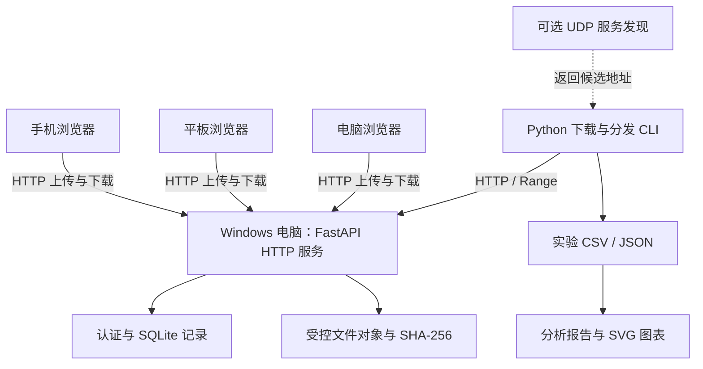

# 基于 HTTP 与 UDP 的局域网文件传输系统设计与实验

*——以断点续传、多客户端分发和文件完整性校验为重点*

| 项目 | 内容 |
| --- | --- |
| 课程 | 网络通信相关课程（待填写正式名称） |
| 学生 | 待填写姓名、学号、班级 |
| 指导教师 | 待填写 |
| 项目 | LAN Distribution Lab |
| 代码仓库 | <https://github.com/cppppercy/lan-distribution-lab> |
| 主要功能代码基线 | `00c3fbe376fb9ba305b4e225cbb06571a83f83ad` |
| 报告日期 | 2026 年 11 月 13 日 |

## 摘要

本次实验围绕电脑、手机和平板之间的局域网文件收发，设计并实现了一个由 Windows 电脑提供服务的文件传输系统。手机和平板无需安装专门的 App，可以在浏览器中配对、上传和下载；电脑端提供 Python 命令行工具，用于可靠下载、分发调度和实验记录。除了基本的 HTTP 文件传输，我重点解决了三个问题：利用 Range、If-Range、强 ETag 和 SHA-256 处理下载中断及文件版本变化；使用顺序、普通并发和固定上限并发三种方式组织多个下载任务；通过 UDP 查找局域网中的服务地址。项目还支持导出实验 CSV/JSON，并根据记录生成统计图表。

2026 年 11 月 13 日，我使用一台 Windows 电脑、一部 iQOO 手机和一台联想平板进行了真实设备验证。三台设备能够分别配对；电脑下载的四种大小文件通过了 SHA-256 校验；手机和平板分别完成 1 MiB 文件的下载、上传回传和电脑端复核；电脑与手机能够同时请求 48 MiB 文件。一次 63 MiB 文件的 Wi-Fi 中断测试还发现，手机浏览器恢复网络后最终从头重新下载，而不是继续之前的下载进度。代码在 Windows GitHub Actions 中通过了 173 项 Python 测试及 2 项前端测试。正式的无线网络三策略性能对照、真实 UDP 广播和 Wireshark 抓包尚未完成，因此报告只对已有功能与测试结果作出结论。

**关键词：** 局域网文件传输；HTTP Range；断点续传；UDP 服务发现；受控并发；SHA-256

## 第一章 实验背景与目的

### 1.1 选题背景

平时在电脑、手机和平板之间传文件，可以使用聊天软件或网盘，但这些工具通常不会展示底层的网络过程。我希望在网络通信课程中实际观察：一个文件怎样通过 HTTP 从服务器传到客户端；下载到一半断开网络时会发生什么；两台设备同时下载时，服务器又是怎样处理请求的。

因此，我选择开发一个能够在家庭 Wi-Fi 或移动热点中运行的局域网文件传输程序。Windows 电脑充当服务器，手机和平板直接通过浏览器访问；程序不依赖云主机，方便控制实验环境和排查问题。项目从最基本的文件收发开始，逐步加入访问授权、完整性校验、断点续传、多客户端任务调度、UDP 发现以及数据分析工具。

这里的“多客户端分发”采用中心服务器模式：接收端都从同一台服务器获取文件，并不是设备之间相互发送文件块的 P2P 系统。

### 1.2 实验目标

本次实验希望完成五个方面的工作：

1. 让电脑与手机、平板在可信局域网中完成配对及文件上传、下载。
2. 对文件内容和版本进行验证，避免中断、文件变化或传输错误被误判为成功。
3. 实现 Python CLI 断点续传，弄清 TCP 可靠传输与 HTTP 应用层恢复的区别。
4. 用顺序、普通并发和固定上限并发三种方式组织任务，记录每个客户端的结果。
5. 提供 UDP 地址发现、自动化测试和实验数据导出，为后续性能对比准备可追溯的数据。

本报告既介绍程序的主要设计，也记录已经完成的实际设备测试。对于尚未测量的无线吞吐量、重传率或策略性能差异，不使用估算值充当实验结果。

## 第二章 相关网络通信理论

### 2.1 TCP 的可靠字节流及其在本项目中的位置

TCP 向应用提供面向连接的有序字节流。客户端通过三次握手建立连接，利用序列号、确认号和重传等机制处理报文丢失或乱序；流量控制避免接收端缓存被过快的发送端淹没，拥塞控制则根据网络反馈调节发送行为。RFC 9293 是 TCP 的现行标准性规范。[RFC 9293](https://www.rfc-editor.org/rfc/rfc9293.html)

本项目没有自行实现 TCP 的握手、确认、重传、拥塞控制或可靠传输算法，而是运行在操作系统 TCP 栈之上。FastAPI/Uvicorn 提供 HTTP 服务，浏览器和 Python 标准库 HTTP 客户端通过 TCP 连接交换 HTTP 报文。TCP 的可靠字节流保证“一个连接内的字节交付语义”，但不自动回答“客户端得到的是不是同一文件版本”“下载完成后文件是否完整”或“应用应如何在一次连接失败后恢复”；这些是项目在 HTTP 与文件层继续处理的问题。

例如，一次 TCP 重传只说明传输层对某些报文段做了恢复；它不等于应用层已经进行了断点续传。反过来，CLI 重新发起一次携带 Range 的 HTTP 请求，也不意味着此前一定发生了 TCP 重传。报告中的协议层次区分对后续抓包解释尤其重要。

### 2.2 HTTP/1.1 文件传输

HTTP 是无状态的应用层请求—响应协议。客户端用 `GET` 获取文件或元数据，用 `POST` 上传 multipart 文件；服务端通过状态码和响应头表达处理结果。RFC 9110 定义了 HTTP 语义、状态码、条件请求和范围请求等通用规则。[RFC 9110](https://www.rfc-editor.org/rfc/rfc9110.html)

本项目的文件下载接口为 `GET /api/files/{file_id}/content`。无 Range 头时，服务端返回完整 `200` 响应；文件由受控对象路径分块读取，不把整个大文件装入内存。上传接口 `POST /api/uploads` 采用有界 multipart 流解析，接收过程中统计实际字节数并同时计算 SHA-256。HTTP 状态码还承担应用错误表达：例如无会话返回 `401`，权限范围不足返回 `403`，请求过大返回 `413`，存储空间或配额不足返回 `507`。

HTTP/1.1 位于 TCP 之上，因此其单个响应字节仍由 TCP 传输；但 HTTP 的资源 URI、状态码、ETag 和条件请求使应用可以表达“正在访问哪个不可变文件对象”以及“是否可以安全继续旧的局部文件”。

### 2.3 HTTP Range、If-Range 与文件版本保护

对于大小为 $S$ 字节、从 0 开始编号的对象，`Range: bytes=a-b` 表示请求闭区间 $[a,b]$；`Range: bytes=a-` 表示从 $a$ 到末尾；`Range: bytes=-k` 表示最后 $k$ 个字节。本项目只支持单一范围，避免多范围 MIME 响应带来的额外解析复杂度。

服务端的实际语义如下。

| 场景 | 响应 | 关键含义 |
| --- | --- | --- |
| 未携带 Range | `200` | 返回完整对象 |
| 合法且可满足的单 Range | `206` | 返回指定字节，并携带 `Content-Range`、范围长度、`Accept-Ranges` 和强 ETag |
| 范围不可满足 | `416` | 返回 `Content-Range: bytes */S` |
| 多范围或非法语法 | `400` | 明确拒绝，不返回不确定的字节集合 |
| If-Range 不等于当前强 ETag | `200` | 忽略旧 Range，返回完整当前对象，禁止错误拼接 |

本项目的 ETag 是与文件 SHA-256 对应的强版本标识。CLI 若已有 `.part` 文件，会读取邻接状态文件中的对象大小、ETag、SHA-256 和已落盘偏移量 $o$，发送 `Range: bytes=o-` 与 `If-Range: <etag>`。收到严格匹配的 `206` 后才追加；收到完整 `200`、`416`、错误的 `Content-Range` 或 ETag 时，旧工件被隔离并从头下载，而不是继续拼接。最终仍要流式计算 SHA-256；只有大小和哈希都正确，才以原子方式发布最终目标文件。

这种机制解决的是**应用层版本一致性和恢复**，而非重复实现 TCP。它特别适用于“连接中断后服务器对象可能已经替换”的情况：即使文件大小未变，ETag 不匹配也会阻止错误续传。

### 2.4 UDP 服务发现

UDP 面向数据报，提供较少的协议机制，交付、顺序和去重均不由 UDP 保证；需要有序可靠字节流的应用应使用 TCP。[RFC 768](https://www.rfc-editor.org/rfc/rfc768.html) 因此，本项目仅把 UDP 用于低负载的候选服务发现，而不传送文件内容。

当操作者显式使用 `serve --discover --host <私有 IPv4>` 时，独立的 UDP responder 才会启动。发现请求和响应都是不超过 1 KiB 的 UTF-8 JSON：请求含协议名、版本、`type=discover` 和随机 `request_id`；响应回显该 `request_id`，并包含非秘密的实例标识、服务名、HTTP 端口、`requires_pairing` 和功能字段。客户端仅接受私有或回环 IPv4 来源，使用**UDP 源 IP 加响应中的 HTTP 端口**构造候选 URL，而不信任正文中的 URL；不匹配的 request_id、畸形/超大响应和不可信来源会被丢弃。

UDP 广播的范围受限于当前广播域，校园 Wi-Fi 的客户端隔离、跨 VLAN、多个网卡和 Windows 防火墙均可能使发现失败。因此发现失败时仍可手动输入服务器 URL。更重要的是，UDP 响应不携带 Cookie、Bearer token、配对码、文件信息或目录路径；发现成功只表示“存在一个候选地址”，设备仍必须配对。

### 2.5 文件完整性与访问控制

Python 的 `hashlib.sha256()` 可按块调用 `update()`，最终得到完整字节序列的摘要。[Python hashlib 文档](https://docs.python.org/3/library/hashlib.html) 服务端在上传时对 staging 文件流式计算 SHA-256，并把哈希、大小和 ETag 与不可变对象元数据一同保存。CLI 下载结束后再次计算本地文件的 SHA-256。哈希校验可以发现最终内容不一致，但不提供 HTTP 链路加密，也不能单独阻止实时中间人攻击。

授权采用“短时一次性六码配对码换限时会话”。Windows 主机操作员只能在本机命令行创建配对码，选择 `read` 或 `read_write` 权限；配对码默认十分钟过期且只能兑换一次。浏览器兑换成功后使用 `HttpOnly; SameSite=Strict` Cookie，CLI 则在响应体中一次取得 256-bit Bearer token。服务端仅保存令牌摘要，绝不把令牌放在 URL、前端存储、示例截图或日志中。会话绝对有效期为八小时，支持撤销；写操作还要求 Cookie 请求的 Origin 精确匹配服务 Origin。

当前实现主要使用 HTTP，未提供 TLS。短时令牌、Origin 检查和权限范围能降低未授权访问与常见跨站请求的风险，但不能抵御同一局域网内的窃听、恶意接入点或主动中间人。

## 第三章 系统需求与总体设计

### 3.1 需求与设计思路

系统由 Windows 中心服务器、浏览器客户端和 Python CLI 三部分组成。这样的安排是为了同时兼顾日常使用与课程实验：浏览器方便手机、平板操作，而 Python CLI 能够更准确地管理下载进度、版本校验、并发数和测试记录。

| 实际问题 | 采用的实现 | 验证方式 |
| --- | --- | --- |
| 手机和平板直接访问电脑文件 | FastAPI 与 Vue 页面 | 三台真实设备配对和文件收发 |
| 防止未经授权的读取和上传 | 一次性配对码、读写权限与会话撤销 | 自动化权限测试、手机实际退出 |
| 下载中断或版本变化 | 强 ETag、Range/If-Range、SHA-256 | 故障注入、文件往返哈希校验 |
| 多个客户端同时下载 | 顺序、普通并发、受控并发调度 | 本机调度测试、真实设备功能并发 |
| 减少手动寻找地址 | 可选 UDP 广播发现与手动 IP 回退 | 协议自动化测试；真实广播待测 |
| 保存可比较的实验数据 | 独立试验目录、CSV/JSON 与图表 | 自动化数据校验测试 |

我没有把复杂的断点续传逻辑放到移动浏览器中，因为浏览器对于部分文件、后台任务和下载保存行为的控制有限；需要准确恢复和校验时，使用专门的 CLI 客户端更合适。

### 3.2 总体架构



图 1 系统总体结构。文件内容始终由 Windows 中心服务器提供，UDP 只用于寻找服务地址。`app.py` 负责 HTTP 接口，`auth.py` 负责会话，`files.py` 和 `storage.py` 负责文件及状态，`client.py`、`distribution.py` 分别负责命令行下载和任务调度；`experiment.py`、`analysis.py` 将原始记录整理为图表和分析结果。

### 3.3 关键数据流

| 流程 | 主要步骤 | 一致性或安全要点 |
| --- | --- | --- |
| 浏览器配对与上传 | 本机生成码 → 浏览器提交码 → Cookie 会话 → 有界 multipart → staging → SHA-256 → 原子发布 | 配对码一次性；上传需 `read_write`；文件名不决定路径；失败清理 staging |
| 授权下载 | `read` 会话 → 元数据/内容 GET → 服务端分块读取 → 浏览器原生下载 | 服务端已发送完响应不等于浏览器已经保存成功 |
| CLI 恢复下载 | 读取 `.part.json` → 元数据预检 → Range + If-Range → 分块 fsync → 最终 SHA-256 → 原子发布 | 版本或响应异常时隔离旧 `.part`，禁止错误追加 |
| UDP 后连接 | UDP 请求/响应 → 生成候选 URL → 用户配对 → 正常 HTTP 操作 | 发现不携带凭据，不授予权限，失败可手动 URL 回退 |
| 多客户端分发 | 每个逻辑客户端独立凭据和输出 → 策略调度 → 每客户端记录 → 汇总 JSON/SQLite | 控制器侧调度，不新增服务端调度协议，不等同真实多设备 |
| 实验与分析 | 固定计划 → 新 trial 目录 → manifest/CSV/原始 JSON → 只读一致性校验 → SVG/Markdown | 失败/取消保留；不合并不可比条件；不读取 PCAP |

## 第四章 关键功能设计与实现

### 4.1 服务端与 Web 页面

`src/lan_distribution_lab/app.py` 中的 `create_app()` 组合健康接口、配对、会话撤销、文件列表、元数据、上传、下载和传输任务查询。默认入口 `python -m lan_distribution_lab` 固定监听 `127.0.0.1:8000`；只有 `serve --host <私有 IPv4>` 才会监听指定局域网地址，且实现拒绝 `0.0.0.0`、公网地址与主机名。Windows `scripts/start-lan.ps1` 是显式 LAN 启动的便利脚本，会选择私有地址并使用同一数据目录；它不会修改 Windows 防火墙、NAT 或路由器端口映射。

Vue 页面位于 `web/src/`。页面提供六码配对、文件列表、XHR 上传进度、浏览器原生下载发起、错误提示与会话退出。前端不把 token 写进 URL、二维码、localStorage 或 sessionStorage，而是依赖 HttpOnly Cookie。浏览器下载的 UI 只能准确表达“已发起下载”，不能把服务器响应完成误报为文件已在移动端保存。

### 4.2 流式文件收发与对象模型

文件对象使用服务器生成的 UUID `file_id`，内部对象名也是服务器生成的，展示名只用于 UI 与安全的 `Content-Disposition`。`files.py` 将上传先写入 `managed_root/staging`；`multipart.py` 以有限缓冲解析单文件 multipart，避免框架预先无界累计请求体。上传过程中按块更新 SHA-256 和实际字节计数，完成后检查单文件限制、总配额、可用磁盘空间、普通文件属性及链接/reparse-point 边界，再发布到 `objects/<file_id>` 并写入 SQLite 元数据。

对象一旦发布即作为不可变快照使用；同名内容或替换内容产生新的 `file_id`，不会覆盖既有对象。这使 `size_bytes`、`content_sha256` 和强 ETag 指向同一个字节序列。空文件、Unicode 文件名与重名展示名均有自动化覆盖，其中重名通过不同 UUID 区分，而不是通过覆盖实现“更新”。

### 4.3 会话认证和权限边界

`auth.py` 将认证解析封装为可复用依赖：`require_read` 用于列表、元数据和下载，`require_read_write` 用于上传。配对码与访问令牌均由安全随机数产生，服务端以 HMAC-SHA-256 摘要持久化；SQLite 的事务用于避免同一配对码被并发重复兑换。无效、过期和撤销的凭据统一拒绝，撤销后的重复请求返回 `401`。

浏览器 Cookie 状态变更还需要 Origin 校验。CLI 的 Bearer 凭据不依赖浏览器 Origin，但下载命令不接受 `--token` 形式的命令行参数，默认无回显读取 token，或使用 `--pair` 在内存中即时兑换配对码。该设计降低终端历史、URL、日志和前端脚本泄露凭据的风险，但不改变 HTTP 明文传输的局限。

### 4.4 CLI 可靠下载

`client.py` 中的 `ResumableDownloader` 将临时数据保存在目标文件同目录的 `.part` 与 `.part.json` 中。状态文件只记录 server、`file_id`、ETag、总大小、SHA-256 和已写入字节数，不记录 token 或绝对路径。每次续传前先读取服务端元数据，再严格校验 `206` 的 Content-Range、Content-Length、ETag 与实际接收字节；每块写入后 fsync 并原子更新状态文件。

若服务器返回 `200`、`416`，或 ETag、范围、大小、本地状态不一致，客户端将旧工件改名隔离，有限次重启下载；收到错误 `206` 不写入新字节。成功路径要求最终大小和 SHA-256 都匹配，随后以不覆盖已有用户文件的方式发布目标文件。该行为已在可控本地 transport/HTTP 服务中覆盖中断、版本变化、损坏 partial、超时和写入失败，但真实 WLAN 的断线恢复仍待实验。

### 4.5 多客户端分发策略

为了比较多任务执行方式，我在 `distribution.py` 中实现了三种调度策略。它们复用同一个可靠下载器，区别在于何时启动任务。每个逻辑客户端都有自己的会话、输出目录和任务标识，便于发现某个客户端失败时是否影响其他任务。

| 策略 | 执行方式 | 主要观察指标 |
| --- | --- | --- |
| 顺序（sequential） | 前一个任务完成后再启动下一个 | 整批任务完成时间 |
| 普通并发（parallel） | 同时启动多个任务，数量有安全上限 | 请求能否重叠、总耗时 |
| 受控并发（controlled） | 最多同时运行 `max_concurrent` 个任务，其余按 FIFO 等待 | 活跃任务上限、排队时间、执行时间 |

受控并发的实现并不复杂，但它需要区分“排在队列中”和“正在传输”两种状态：一个任务结束后才允许下一个等待任务进入执行阶段。程序分别记录 `wait_seconds`、客户端执行时间和批次总耗时，以及观察到的最大活跃任务数。

这三种策略是**控制器电脑中的多个逻辑客户端**。它们可以验证调度程序是否正确，但还不能自动控制手机、平板上的浏览器。因此，真实设备同时下载的测试与三种策略的严格性能比较必须分开记录。

### 4.6 UDP 局域网发现

`discovery.py` 提供有界 JSON 的请求—响应协议，以及客户端去重、排序、超时和来源校验。服务端仅在显式开关下运行 responder；客户端发现超时时会提示手动 URL。协议包含 `request_id` 回显以减少旧响应或串包被误认的风险，并对来源数量和请求频率限速。由于 UDP 本身不提供认证与保密，发现响应始终声明 `requires_pairing: true`，不会自动提交 Bearer、配对码或发起文件传输。

### 4.7 实验记录与分析

`experiment.py` 按指定文件、策略和轮次调用现有分发功能。每轮使用新目录，防止把此前已经下载完成的文件误算为本轮传输。程序导出 `experiments.json`、`trials.csv`、`clients.csv` 和原始下载结果；失败、取消、中断也会记录，不能因为某几轮失败就只保留成功数据。

`analysis.py` 则读取这些记录，先核对文件、轮次、客户端状态和字节量是否一致，再按文件版本、大小、客户端数和测试环境等条件分组，生成 SVG 图表与 Markdown 分析。这样后续比较不同策略时，至少能够知道某个平均时间究竟来自哪些试验，而不是仅凭截图得出结论。

### 4.8 我认为比较有价值的设计

本项目最有特点的地方，不是使用了多少框架，而是把普通文件收发中容易忽略的问题做成了可观察、可验证的功能。

**第一是文件版本保护。** TCP 可以可靠传送字节，但不能告诉下载器某次断线后的文件是否仍然属于同一个版本。项目结合 ETag、If-Range 和 SHA-256，要求版本和内容都核对正确后才发布下载结果。

**第二是并发行为可控制。** 除了让多个请求同时发生，还能够指定固定的并发上限，把排队等待与真正的下载耗时分开记录，便于分析“并发更多”是否一定意味着“完成更快”。

**第三是测试记录可追溯。** 从每个客户端的状态到每轮实验的 CSV/JSON，再到分析图表，都保留了对应关系。对失败或数据不一致的情况，程序不自动生成看起来正常的统计结果。

## 第五章 实验环境与实验方案

### 5.1 真实设备与软件环境

实际验收使用 Windows 电脑作为中心服务器，手机和平板在同一局域网中通过浏览器访问。2026 年 11 月 13 日测试时的设备如下：

| 设备 | 型号与软件 | 作用 |
| --- | --- | --- |
| Windows 电脑 | Lenovo 83DG；Windows 25H2（build 26200）；Edge 157 | 运行服务器、下载、回传校验 |
| 手机 | iQOO 15T，自带浏览器 | 配对、上传下载、断开 Wi-Fi |
| 平板 | 联想小新 Pad 2024，自带浏览器 | 配对、上传下载 |

这次服务器运行在私有局域网地址 `192.168.31.42:8003`，使用 HTTP，没有启用 TLS。移动端具体系统版本未记录，不写成已经确认的版本。此前还在 Windows 移动热点环境下完成过电脑与手机的基础收发。

测试文件是合成内容，不包含私人资料。主要准备了 0 B、1 MiB、16 MiB 和 48 MiB 四种大小的文件，其中 1 MiB 文件采用中文文件名；断网实验另外使用 63 MiB 文件。三台设备使用不同的一次性配对码。

代码层面的自动化验证在 GitHub Actions `windows-latest` 中进行，使用 Python 3.12、Node.js 24，采用临时目录、合成文件与可控故障，不依赖真实手机或外网。

### 5.2 自动化功能正确性验证

自动化测试覆盖的重点不是测得无线吞吐量，而是验证协议和失败边界。例如：

- 健康接口稳定 JSON 与默认 loopback 监听；
- 配对码的有效期、一次性消费、并发兑换、限速、Cookie/Bearer、scope、撤销与 Origin；
- 文件上传下载、0 B、Unicode/重名、SHA-256、非法路径、配额、`ENOSPC`、客户端断开、staging 清理和资源槽位；
- `200/206/416`、单 Range、If-Range 版本回退、范围片段拼接后的 SHA-256；
- CLI 中断恢复、旧版本隔离、超时、磁盘错误和 token 不落盘；
- 三种调度策略的状态隔离、FIFO/上限、JSON/SQLite 记录；
- UDP 请求/响应、request_id、来源过滤、限速、超时和无凭据；
- T010 导出与 T011 数据一致性、比较分组、抓包摘要隐私和输入只读。

### 5.3 后续真实网络性能对比设计

后续实验应在每个对照组中固定文件内容及 SHA-256、服务端配置、网络环境、客户端数、超时和重试参数，并至少重复三轮。建议从下列维度逐步展开：

| 变量 | 建议取值或对照 | 记录要求 |
| --- | --- | --- |
| 文件大小 | 小、中、大三个预先生成的固定对象 | UUID、大小、SHA-256 |
| 策略 | sequential、parallel、controlled | controlled 额外记录上限 |
| 客户端数 | 2、3 或其他实际可用数量 | 设备型号、浏览器/CLI 版本 |
| 断线恢复 | 正常、人工断开再恢复 | 中断位置、Range/If-Range 行为、最终哈希 |
| 网络环境 | 家庭 Wi-Fi、移动热点等分别建组 | 拓扑、频段（若可得）、IP 网段；不记录密码 |

不能把不同网络、不同文件或不同客户端数组合并为同一策略对照，也不能用同一台电脑上的逻辑客户端数据替代真实手机和平板结果。每次执行应保留 experiment 输出目录，并让 analyze 在输入目录外创建新的报告目录。

### 5.4 评价指标与单位

设某个 trial 的完整成功客户端数为 $n_s$，单文件大小为 $B$ 字节，批次墙钟完成时间为 $T$ 秒，则本项目的应用层有效载荷吞吐量定义为：

```text
P_app = (n_s × B) / T    [B/s]
P_MiB = P_app / 1024 / 1024    [MiB/s]
```

它表示成功应用载荷除以该批次墙钟时间，不是 TCP payload 速率、网卡速率或无线链路带宽。完整成功率定义为：

```text
R_complete = N_completed / N_planned
```

其中 $N_planned$ 包含失败和取消 trial，因而不能通过删除失败样本提高成功率。对于受控并发，还应记录平均排队等待时间：

```text
W_avg = (Σ wait_seconds_i) / N_clients    [s]
```

在同一个完整成功 trial 中，若第 $i$ 个成功客户端的应用层完成速率为 $x_i = downloaded_bytes_i / duration_seconds_i$，且样本数 $n ≥ 2$、所有 $x_i$ 为正的有限值，则 Jain 公平性指数为：

```text
J = (Σ x_i)^2 / (n × Σ x_i^2)
```

当样本不足、速率为零、缺失或非有限时，Jain 指数应显示为 unavailable，而不是填 0。该指数只描述同一 trial 的应用层完成速率分布，不是 TCP 层公平性结论。

### 5.5 Wireshark 抓包方案与隐私约束

真实实验若需要包级证据，可使用 Wireshark 的用户文档与显示过滤器参考。[Wireshark Documentation](https://www.wireshark.org/docs/) 操作时只选择实际参与实验的一张网卡，限定服务 IP、端口和明确时间窗口；先启动捕获，再运行单次实验，结束后立即停止。可观察 TCP 三次握手、FIN/RST、HTTP `200/206/416`、Range 请求和 `tcp.analysis.retransmission` 标记。

这些观察存在边界：`tcp.analysis.retransmission` 是 Wireshark 的分析标记，不能直接推出物理断网次数、丢包率或应用失败数；HTTP `206` 说明发生了范围响应，不等于 TCP 重传。RTT 也必须注明使用的字段、会话和时间窗口，不能与批次 `duration_seconds` 直接等同。

由于当前 HTTP 传输可能包含配对码、Cookie、Bearer token、文件名和文件内容，原始 PCAP/PCAPNG 应留在操作者私有目录，不能提交到 Git 或附在本报告。若需要供 analyze 使用，只导出不含 IP、路径、自由文本和凭据的离线摘要；未获得真实抓包时，本报告只能描述方法，不能写成已经观察到某种 TCP 行为。

## 第六章 实验结果与分析

### 6.1 自动化测试

项目主要功能在 Windows GitHub Actions 中通过测试，记录对应代码基线 `00c3fbe376fb9ba305b4e225cbb06571a83f83ad`：

| 检查 | 实际结果 |
| --- | --- |
| Python pytest | **173 passed，1 warning** |
| Vue 前端测试 | **2 passed** |
| TypeScript 类型检查与 Vite 构建 | 通过 |
| 原始记录 | [GitHub Actions run 42847067827](https://github.com/cppppercy/lan-distribution-lab/actions/runs/42847067827) |

这些测试覆盖配对和权限、流式上传、HTTP Range、CLI 续传、调度上限、UDP 消息以及实验数据校验等功能。它们说明程序在受控环境下通过相应测试，并非 173 次真实无线网络实验。

### 6.2 电脑、手机与平板的实际测试

2026 年 11 月 13 日，我在同一私有局域网中完成了以下操作：

| 测试内容 | 操作和观察 | 结果 |
| --- | --- | --- |
| 独立配对 | 电脑、手机、平板分别使用不同的一次性码进入文件页 | 通过 |
| 电脑文件下载 | 对 0 B、1 MiB、16 MiB、48 MiB 四个对象检查大小与 SHA-256 | **4/4 匹配** |
| 手机文件往返 | 手机下载 1 MiB 中文名文件，再上传；电脑回下载并计算哈希 | **SHA-256 匹配** |
| 平板文件往返 | 平板重复 1 MiB 下载、回传和电脑复核 | **SHA-256 匹配** |
| 大文件下载 | 手机、平板分别保存 48 MiB 文件 | 浏览器确认保存；移动端未独立计算哈希 |
| 功能性并发 | 电脑和手机在 10:48:11 同秒请求 48 MiB 文件，完整响应分别于 10:48:13 和 10:48:18 结束 | 两台设备能够同时请求 |
| Wi-Fi 中断 | 手机下载 63 MiB 时关闭并恢复 Wi-Fi，需要人工继续，随后重新收到完整响应 | **浏览器从头重新下载** |
| 会话撤销 | 手机退出后刷新返回配对页，服务端记录 10:56:21 撤销会话 | 通过 |

其中 1 MiB 文件以及手机、平板回传副本在服务器和电脑端得到相同的 SHA-256：

`7bb3796a2472badd79c03bf02bc3155480b5e05fd2b3301746ed293dbce3f3da`

这个结果较直接地证明了本次小文件双向传输没有发生内容变化。48 MiB 文件虽然已经在移动浏览器中完成保存，但移动端没有单独计算哈希，因此不把它写成已完成端到端哈希验证。

**插图位置：** 可在最终提交版本中加入三台设备配对、文件列表、回传及电脑端哈希对照的脱敏截图。原始截图与 CSV、SQLite 只读摘要保存在本地被 Git 忽略的测试目录中，尚未公开附在仓库。

### 6.3 实际测试中发现的问题

**浏览器下载完成与服务器记录并不是一一对应的。** Edge 保存含空格的中文文件名时，部分空格被替换为下划线，但文件大小及 SHA-256 没有改变。iQOO 手机浏览器有时会把一次逻辑下载拆成多个完整或 Range 请求，并出现重试和未及时结束的 `started` 任务记录。也就是说，服务端的一条传输记录不一定等于用户的一次下载操作，更不能直接拿传输记录的行数计算成功率。

**Wi-Fi 恢复不等于浏览器能够续传。** 在 63 MiB 文件的测试中，手机断网后需要人工继续，最终观察到重新发送完整文件，而不是从此前进度恢复。项目的 Python CLI 通过 `.part`、ETag、Range 和 SHA-256 设计了可验证的断点续传流程，并已通过模拟故障测试；但它在真实 Wi-Fi 中断情况下的表现还需要另行测试。这个差异也是本项目将浏览器下载与 CLI 可靠下载分开的原因之一。

这些实际现象让我认识到，“服务器已经发送完响应”“浏览器显示下载完成”和“下载文件经过内容校验”并不是同一件事，做网络应用时必须分别考虑。

### 6.4 尚待进行的网络性能实验

功能性双设备并发已经验证，但还没有在相同无线环境下对 sequential、parallel、controlled 三种策略进行至少三轮的严格耗时对照。真实 UDP 广播发现和匹配时间窗口的 Wireshark 抓包同样尚未执行。

| 项目 | 后续应补充的证据 | 状态 |
| --- | --- | --- |
| 三策略性能对照 | 固定文件、客户端数和网络，记录至少三轮完成时间、吞吐量及失败情况 | 待实测 |
| CLI 真实断线续传 | Range/If-Range 请求、恢复前后字节量与最终 SHA-256 | 待实测 |
| 真实 UDP 广播 | 局域网实际发现结果、超时和手动 IP 回退 | 待实测 |
| Wireshark 抓包 | 与实验对应的 TCP/HTTP 抓包与脱敏摘要 | 待实测 |

因此，本报告可以确认现有功能和真机文件传输的结果，但不能给出不同策略在真实无线网络中“提升了多少百分比”的结论。

## 第七章 系统不足与后续改进

目前系统的访问控制、文件校验和传输异常处理已经具备基本功能。默认只在本机监听；进入 LAN 模式需要显式指定私有 IP；上传文件先写入受控临时目录，确认后发布；CLI 下载也只有在大小和哈希正确时才保留最终文件。这些设计减少了误覆盖、越权访问和文件不完整的问题。

不足之处主要有三个。第一，当前使用的是 HTTP，没有 TLS，配对码和会话令牌仍可能被同网段设备窃听，因此只适合在自己控制的可信局域网实验。第二，手机浏览器在断网后选择重新下载，且一次逻辑操作可能产生多个 HTTP 请求；如果以后统计移动端传输性能，需要把浏览器重试和一次完整下载关联起来。第三，移动端大文件本地 SHA-256、真实 UDP 广播、Wireshark 抓包与多轮性能对照还没有完成，部分 Windows 文件系统边界也需要进一步实测。

后续可以先补齐这些测试，再根据结果决定是否增加 HTTPS、浏览器端更完善的下载体验或动态并发控制，而不是继续堆叠新功能。

## 第八章 实验总结

这次实验从最基本的 HTTP 服务开始，逐步完成了实际可用的网页文件收发、一次性配对、文件版本保护、SHA-256 校验、Python CLI 断点续传、三种多客户端调度方式以及 UDP 地址发现。与只做一个上传下载页面相比，项目更强调传输失败以后如何恢复、不同客户端怎样独立记录状态、文件内容能否确实一致。

实际拿电脑、手机和平板测试后，我发现自动化测试之外还会出现一些容易忽略的细节：例如浏览器下载时可能改写文件名中的空格，一次下载可能对应多条 HTTP 请求，网络中断后也不一定按预期继续。这些现象让我更清楚地理解 TCP 提供的可靠字节流、HTTP 的范围请求和应用层文件完整性之间的分工。

目前系统的主要功能、自动化回归和基本真机传输已完成，正式的无线性能比较及抓包仍有待补充。因此本报告将已经观察到的结果与后续计划区分开来，不把未取得的数据写成实验结论。

## 参考资料

1. Fielding, R. et al. *RFC 9110: HTTP Semantics*. IETF, 2022. <https://www.rfc-editor.org/rfc/rfc9110.html>
2. Eddy, W. (Ed.). *RFC 9293: Transmission Control Protocol*. IETF, 2022. <https://www.rfc-editor.org/rfc/rfc9293.html>
3. Postel, J. *RFC 768: User Datagram Protocol*. IETF, 1980. <https://www.rfc-editor.org/rfc/rfc768.html>
4. Python Software Foundation. *hashlib — Secure hashes and message digests*. <https://docs.python.org/3/library/hashlib.html>
5. FastAPI. *FastAPI Documentation*. <https://fastapi.tiangolo.com/>
6. Wireshark Foundation. *Wireshark Documentation*. <https://www.wireshark.org/docs/>
7. LAN Distribution Lab. [README](../README.md)、[架构文档](ARCHITECTURE.md)、[API 契约](API_CONTRACT.md)、[威胁模型](THREAT_MODEL.md)、[实验记录](EXPERIMENTS.md)、[测试计划](TEST_PLAN.md)、[抓包证据指南](PACKET_CAPTURE_GUIDE.md)。

## 附录 A：关键源码与测试索引

| 类别 | 路径 | 作用 |
| --- | --- | --- |
| HTTP 与 Range | `src/lan_distribution_lab/app.py` | 路由、范围选择、流式下载响应 |
| 认证与 Origin | `src/lan_distribution_lab/auth.py` | 配对、会话、scope、撤销与 Origin 检查 |
| 文件对象 | `src/lan_distribution_lab/files.py`、`multipart.py`、`storage.py` | staging、哈希、配额、SQLite 与有界 multipart |
| CLI 续传 | `src/lan_distribution_lab/client.py` | `.part`、Range/If-Range、响应校验、哈希和发布 |
| 分发与实验 | `src/lan_distribution_lab/distribution.py`、`src/lan_distribution_lab/distribution_store.py`、`src/lan_distribution_lab/experiment.py` | 三种策略、记录、固定 trial 与导出 |
| 分析与发现 | `src/lan_distribution_lab/analysis.py`、`src/lan_distribution_lab/discovery.py` | 原始数据校验/SVG 与 UDP 发现 |
| 后端测试 | `tests/test_auth_storage.py`、`test_file_api.py`、`test_resumable_client.py` | 会话、文件、范围与续传故障边界 |
| 协同与分析测试 | `tests/test_distribution.py`、`test_experiment_runner.py`、`test_analysis.py`、`test_udp_discovery.py` | 策略、记录、分析和 UDP |
| Web 测试 | `web/src/api.test.ts` | 前端 API 封装的基础回归 |

## 附录 B：运行命令与实验资料

以下示例用于说明项目的运行方式。尖括号中的地址和路径需按实际环境替换；详细安装说明见 [README](../README.md)。

```powershell
# 启动本机服务
python -m lan_distribution_lab

# 显式局域网启动（使用自己电脑的私有 IPv4）
python -m lan_distribution_lab serve --host <PRIVATE_IPV4> --port 8003 `
  --data-dir <STATE_DIR> --managed-root <MANAGED_ROOT>

# 为浏览器生成读写配对码
python -m lan_distribution_lab pair create --scope read_write `
  --data-dir <STATE_DIR> --managed-root <MANAGED_ROOT>

# 读取已有实验目录并生成统计图表
python -m lan_distribution_lab analyze `
  --input <EXPERIMENT_DIR> --output-dir <NEW_ANALYSIS_DIR>
```

2026 年 11 月 13 日的真实设备截图、逐项测试 CSV、SQLite 只读记录及哈希校验结果保存在操作者本地的 Git 忽略测试目录中，并未作为公开仓库附件。正式交课程报告时，可选择性地附上已脱敏的真实操作截图、哈希对照记录；不上传配对码、Cookie、访问令牌或未清理的抓包。

若后续需要补做性能实验，建议同时保存测试设备、文件大小与 SHA-256、网络条件、轮次、并发上限、耗时及失败记录，以便图表能够对应真实原始数据。

