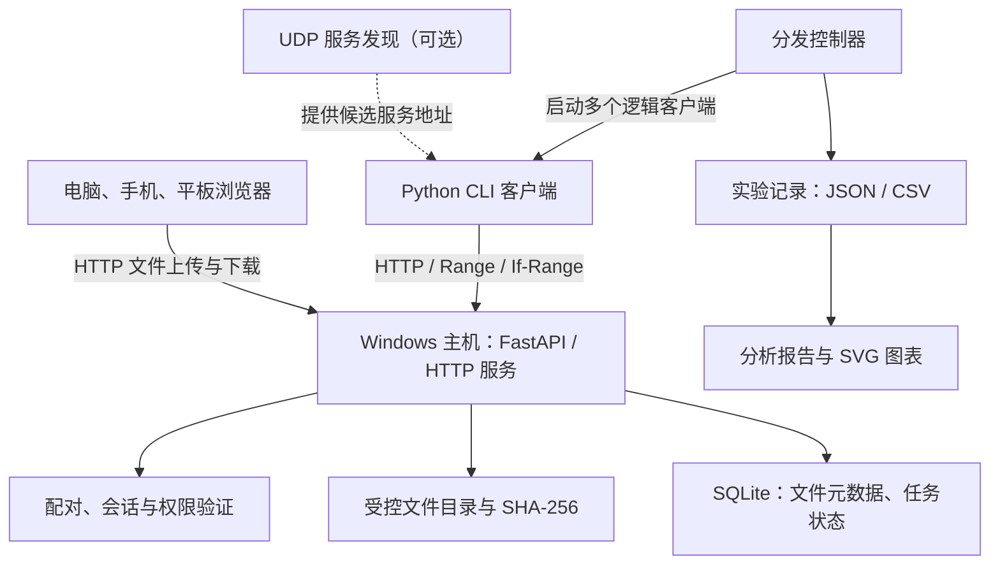
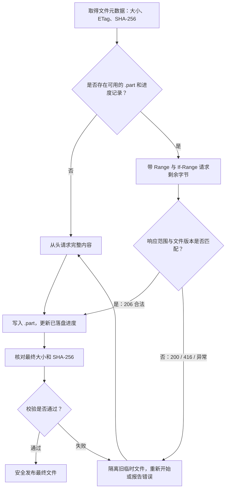
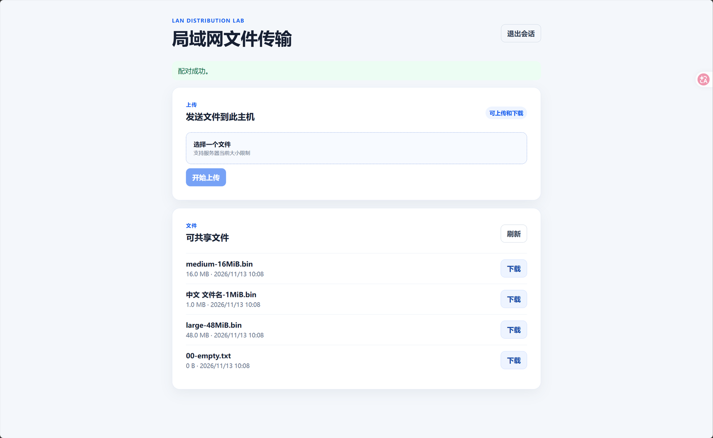
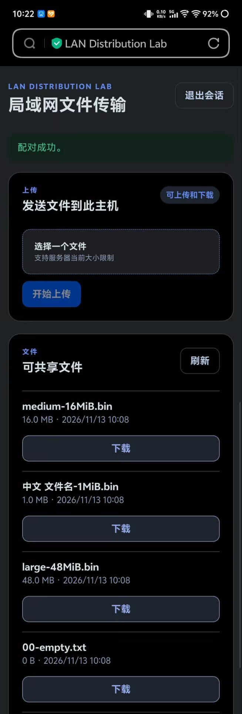
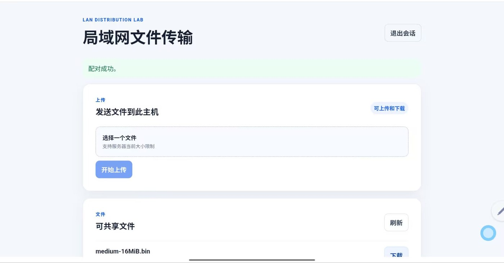
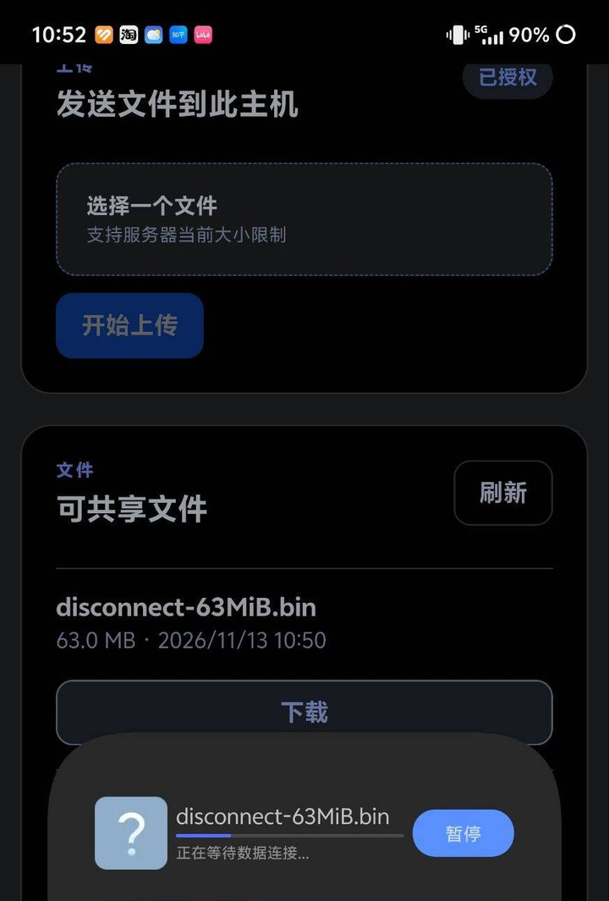

# 局域网文件传输系统的设计与实现——计算机网络课程实验报告

| 项目 | 内容 |
| --- | --- |
| 课程 | 计算机网络 |
| 姓名 | 蔡鹏程 |
| 班级 | 软件2401 |
| 学号 | 2241310871 |
| 项目名称 | LAN Distribution Lab |
| 项目源码 | [GitHub：cppppercy/lan-distribution-lab](https://github.com/cppppercy/lan-distribution-lab) |

## 一、实验目的与项目介绍

### 1.1 选题背景

计算机网络课程学习了 TCP、UDP、HTTP 和客户端—服务器通信等内容。只看协议的概念，比较容易理解“客户端发送请求，服务器返回数据”，但要真正做成一个能在不同设备上运行的程序，还需要考虑如何找到服务器、如何管理文件、传输到一半断开怎么办、多个设备同时访问会怎样等问题。

我平时有在电脑、手机和平板之间传送文件的需求。用聊天软件或网盘可以完成这件事，但无法直接观察请求、响应和文件传输的过程。因此，这次课程项目我选择自己实现一个局域网文件传输系统：在 Windows 电脑上运行服务，手机和平板连接同一个 Wi-Fi 后，通过浏览器就可以访问、上传和下载文件。

项目名称为 **LAN Distribution Lab**。它不仅有可操作的网页，还提供 Python 命令行客户端，能够进行断点续传、组织多个客户端的下载任务，并保存实验数据。整个项目采用中心服务器模式：文件由电脑统一保存并提供服务，各设备通过 HTTP 请求同一个服务器，并不是设备之间直接交换文件块的 P2P 系统。

### 1.2 实验希望解决的问题

在开发过程中，我主要围绕以下几个问题展开：

- **设备之间如何方便地建立连接？** 电脑提供局域网访问地址，移动设备通过浏览器连接；为了减少桌面客户端手动查找地址的步骤，又实现了可选的 UDP 服务发现。
- **文件怎样可靠地传输？** 上传时分块接收，下载时支持 HTTP 字节范围请求，并对文件大小和 SHA-256 进行校验。
- **下载中断后怎样处理已经收到的数据？** 命令行客户端保存部分文件和进度信息，恢复时先确认文件版本，再决定续传还是重新下载。
- **多个客户端一起下载时如何安排任务？** 分别实现顺序、普通并发和固定并发上限三种方式，让并发行为可以控制和记录。
- **怎样检查程序是否真正工作？** 除了自动化测试，还使用电脑、手机和平板实际操作，并保存文件哈希、响应状态和部分运行记录。

项目最终形成了一套可以运行的应用，包括后端 HTTP 服务、响应式 Web 页面、命令行下载与分发工具，以及实验数据分析模块。下面主要介绍系统的设计和实现，最后再说明实际测试情况。

## 二、需求分析与总体方案

### 2.1 使用场景和功能需求

系统主要面向同一个可信局域网中的几台设备。例如，电脑在宿舍或家中连接 Wi-Fi 并启动服务，手机和平板连接同一网络，打开电脑显示的访问地址，在浏览器中输入配对码后就可以查看文件列表。拥有读写权限的设备可以上传文件；只有读取权限的设备可以浏览和下载。

为了让这个程序不仅停留在“网页上传、下载”两个按钮上，我在基础功能以外增加了几项与网络协议直接有关的能力。

| 功能 | 具体需求 | 本项目的实现 |
| --- | --- | --- |
| 局域网连接 | 移动设备不安装专门 App 也能使用 | Windows HTTP 服务 + Vue 浏览器页面 |
| 文件收发 | 上传、下载、文件列表和基本状态提示 | FastAPI 文件接口，分块处理文件内容 |
| 访问授权 | 不能让同一 Wi-Fi 下的任意设备直接访问 | 一次性配对码、会话和读写权限 |
| 完整性校验 | 文件传完以后能够确认内容没变 | SHA-256、文件大小、不可变文件对象 |
| 中断恢复 | 连接断开后不错误拼接旧数据 | Python CLI + Range、If-Range、ETag |
| 多客户端分发 | 能够调整多个任务的启动方式 | sequential、parallel、controlled |
| 地址发现 | 桌面客户端可尝试自动寻找服务 | 可选 UDP 广播发现，失败可手动输入 IP |
| 实验记录 | 能够保存每轮操作数据 | JSON/CSV 导出、统计分析和 SVG 图表 |

这几个模块并不是互不相关的。例如，可靠下载需要先有文件元数据和版本标识；分发控制器会复用可靠下载客户端；实验工具再记录每个分发任务的状态和时间。因此，实际开发时是从基础文件服务逐步扩展到后面的功能。

### 2.2 技术选型

服务端使用 **Python、FastAPI 和 Uvicorn**。FastAPI 负责 HTTP 请求、参数和权限检查，Uvicorn 提供实际的 Web 服务；文件信息、配对码摘要、会话和传输任务记录存放在 **SQLite** 中。数据库不负责保存整个文件的二进制内容，文件本身保存在受控目录里。

浏览器界面采用 **Vue 3 + TypeScript**，主要考虑手机和平板直接访问时的布局适配。界面不承担底层可靠续传的全部逻辑，而是调用服务器已经提供的文件接口。专门的下载、分发与实验程序使用 Python 实现，便于控制请求和记录结果。

这套方案不需要云服务器，也没有引入复杂的分布式存储系统。对于课程实验来说，在一台 Windows 电脑和几台普通设备上就能运行，比较方便观察通信过程。

### 2.3 总体架构



*图 1 系统总体架构。文件通过 HTTP 在设备与 Windows 服务器之间传输；UDP 只用于发现服务地址，分发和数据分析由独立的 Python 模块完成。*

项目的主要代码位于 `src/lan_distribution_lab/`，其中 `app.py` 提供 HTTP 接口，`auth.py` 负责认证，`files.py` 和 `storage.py` 管理文件与数据库，`client.py` 实现下载客户端，`distribution.py` 负责多任务调度，`discovery.py` 处理 UDP 发现，`experiment.py` 和 `analysis.py` 负责实验数据。

### 2.4 一次完整的文件传输过程

以手机上传文件为例，整个过程并不是浏览器直接把文件写入电脑某个任意路径。手机先连接服务器并使用配对码获得会话，随后发起上传请求。服务端检查读写权限和文件大小，把接收到的内容逐块写入临时文件，同时计算哈希；文件接收完成且检查通过以后，才生成服务器自己的文件编号，将对象发布到正式目录，并把元数据写入 SQLite。

客户端下载时，则先经过会话验证，再根据文件编号找到相应的对象。浏览器普通下载直接接收完整内容，Python CLI 可以请求某个字节范围。这种分工既保证普通用户操作简单，又保留了专门研究 Range 和恢复传输的实验入口。

## 三、主要功能的设计与实现

### 3.1 基于 HTTP 的文件上传与下载

本项目使用 HTTP/1.1 作为文件传输协议，底层依靠操作系统的 TCP 连接。TCP 提供可靠、有序的字节流，但“文件是否为正确版本”“传输完成后哈希是否一致”仍需要由应用程序处理。

文件相关的主要接口包括：

| 请求 | 用途 | 典型结果 |
| --- | --- | --- |
| `GET /api/health` | 检查服务器是否正在运行 | `200` |
| `GET /api/files` | 获取有权限查看的文件列表 | `200` |
| `POST /api/uploads` | 上传一个文件 | 成功后返回文件记录 |
| `GET /api/files/{file_id}/content` | 下载完整文件或指定字节范围 | `200` / `206` |
| `POST /api/pairings` | 使用一次性配对码取得会话 | 成功后建立授权 |

上传时采用流式处理，而不是先把完整文件读入内存。这样在传输较大的文件时，服务端不用占用与文件大小相同的内存。上传内容先进入 `staging` 临时目录，完成之后才正式发布；如果请求中断、磁盘空间不够或者超出限制，不能将不完整的临时文件当作正常对象。

下载使用分块读取方式。文件名用于展示，真实存储路径由服务器生成的 UUID 决定。这样即使两个上传文件具有相同名称，也不会互相覆盖；客户端也不能通过输入 `../` 一类的路径访问服务器目录外的文件。

### 3.2 文件完整性、版本管理与 SHA-256

只看 HTTP 响应成功并不足以确定下载得到的文件内容没有改变。因此，服务器在接收文件时计算 SHA-256，并保存文件大小、摘要和版本信息；Python 下载客户端完成传输后，也会计算本地文件的摘要进行比较。

这里采用“一个文件对象对应一个不可变版本”的方式。即使用户又上传了同名文件，服务器也会给它新的 `file_id`，而不是直接覆盖旧对象。这样一来，客户端请求某个编号时，文件的大小和哈希就有稳定的对应关系。

SHA-256 不是加密传输，而是**内容校验**。如果两份文件的 SHA-256 相同，可以作为本次内容一致性检查的依据；它不能代替 HTTPS，也不能说明无线网络中从未发生过重传。

### 3.3 HTTP Range 和 Python CLI 断点续传

断点续传是本项目中比较重要的一部分。假设一个文件已经下载了 4 MiB，后面因为网络中断而停止。如果每次都从头开始下载，已经收到的内容就没有得到利用。HTTP 的 `Range` 请求可以让客户端只请求后面的字节，例如：

```http
GET /api/files/{file_id}/content HTTP/1.1
Range: bytes=4194304-
If-Range: "<当前文件的强 ETag>"
```

*上面是协议使用方式的示意，不是从实机抓包中复制的原始报文。*

如果请求范围合法且文件版本匹配，服务器返回 `206 Partial Content`，并通过 `Content-Range` 告诉客户端这次返回的字节位置。没有指定 Range 时，服务器返回完整文件 `200`；范围不可满足时可能返回 `416`。本项目支持单一字节范围，没有实现多范围响应。

仅靠 Range 还不够。例如下载过程中服务端的文件版本改变了，即使新文件大小相同，也不能把新文件的后半段直接接在旧文件上。为此，项目使用强 ETag 和 `If-Range` 判断是否仍在下载同一个版本。客户端只接受符合预期的 `206`、范围、长度和 ETag；否则会把旧的临时数据隔离，重新下载。

命令行客户端下载的核心步骤如下：



*图 2 CLI 下载恢复的主要判断过程。异常重新开始有次数限制，不会无限重试。*

具体实现位于 `client.py`。程序把未完成内容保存为 `.part`，同时用 `.part.json` 保存文件编号、ETag、总大小、SHA-256 和进度，不将访问令牌写进这些文件。写入的数据和进度记录要保持一致，最后再次计算 SHA-256，确认内容正确后才发布最终文件，并且不会直接覆盖用户已有的同名文件。

开发和测试中专门考虑了截断的 HTTP 响应、错误的 `Content-Range`、文件版本变化、损坏的 `.part` 文件以及写入失败等情况。这些问题如果不处理，程序可能显示下载完成，但最终文件实际无法使用。

### 3.4 配对码、会话与访问权限

局域网连接成功不代表设备应该自动拥有文件访问权限。如果只要知道 IP 就能读写电脑里的文件，程序在多人使用的 Wi-Fi 下会有明显问题。

我的做法是在电脑本机生成一次性的六位配对码。手机或平板输入配对码以后，由服务器创建有有效期限的会话。配对码默认十分钟过期、只能使用一次，权限分为 `read` 和 `read_write`：前者可以看文件列表和下载，后者还可以上传。会话可以主动撤销。

浏览器使用 HttpOnly Cookie 保存会话，Python CLI 则使用 Bearer Token，程序不把令牌放在 URL 中。真正的权限检查在服务端进行，而不只是通过隐藏网页按钮实现。服务器默认只监听 `127.0.0.1`；要让其他设备访问，需要操作者显式选择局域网私有 IPv4 地址。

这一设计主要解决实验中“谁可以访问”和“文件能不能被误改”的问题。由于目前仍使用 HTTP 而非 HTTPS，网络传输并没有加密，因此只适合在可信、自己管理的局域网里使用。

### 3.5 手机和平板使用的 Web 页面

项目的 Web 页面使用 Vue 3 实现。它不要求手机和平板另外安装客户端，只要浏览器能够打开电脑提供的地址，就能进行配对、查看文件列表、选择上传文件和发起下载。上传进度由浏览器提供的真实上传事件更新，页面还会显示请求失败、没有文件等情况。

之所以没有把“可靠断点续传”直接作为浏览器页面功能，是因为移动浏览器的下载方式受平台影响较大。浏览器可能自己拆分 Range 请求、重试或重新下载，网页并不总能控制保存下来的部分文件。所以项目把严格管理本地 `.part` 文件、恢复进度和哈希校验的能力放到了 Python CLI 中，两者共享同一套 HTTP 服务端接口。

这种设计在实际测试中得到了印证：手机浏览器在一次 Wi-Fi 中断后最终重新下载了完整文件，而 CLI 的续传设计需要由专门的客户端实现。

### 3.6 多客户端分发与并发控制

如果几个客户端都要下载同一个文件，最直接的办法是全部同时发起请求。但任务启动得越多，服务器的磁盘、网络和客户端自身的处理能力不一定越够用。因此，我实现了三种不同的任务组织方式，方便在相同文件和客户端数量下进行对照。

| 分发方式 | 任务如何执行 | 主要用途 |
| --- | --- | --- |
| 顺序（`sequential`） | 一个客户端完成后再启动下一个 | 观察逐个完成的总耗时 |
| 普通并发（`parallel`） | 多个客户端下载可以同时开始 | 观察请求重叠时的表现 |
| 受控并发（`controlled`） | 最多同时执行设定数量的任务，其余排队 | 观察并发上限和等待时间 |

受控并发使用固定的 `max_concurrent` 参数。比如有 5 个下载任务，把上限设为 2，就只能同时运行最多 2 个任务；某个任务完成后，队列中的下一个任务才有机会开始。程序按 FIFO 方式处理等待队列，并为每个客户端分别记录等待时间、下载执行时间、字节数和最终状态。

这些时间有不同含义：**排队等待时间**是任务还没有得到执行机会时的等待；**客户端执行时间**是任务实际开始后到结束的时间；**批次总耗时**则反映所有任务从开始安排到结束的整体过程。把三者分开，后续才能分析并发上限到底影响了哪个环节。

分发控制器位于 `distribution.py`。每个逻辑客户端都使用独立的会话和输出目录，防止多个任务互相覆盖文件。这里要注意，控制器可以在一台电脑上模拟多个独立会话，但这不代表手机和平板已经接受控制器的统一调度。实际移动设备同时下载属于另一类功能测试。

### 3.7 UDP 局域网服务发现

除了手动输入 IP，我还实现了一个可选的 UDP 服务发现功能，主要供运行 Python CLI 的另一台电脑使用。服务器在显式开启发现后响应较小的 UDP 请求，返回服务名、HTTP 端口等信息。客户端使用随机 `request_id` 匹配请求与响应，并检查协议版本和来源地址，减少接收错误消息的情况。

UDP 不负责传输文件内容，真正上传和下载仍使用 HTTP/TCP。发现得到的只是一个候选地址，不等于已经取得访问权限，因此连接之后仍需要配对。如果广播被 Windows 防火墙、路由器或网络隔离策略限制，用户可以手动输入服务器 IP。

本次已经完成相关协议的自动化测试，但没有把真实 Wi-Fi 的 UDP 广播实验列为已经完成的实测。

### 3.8 实验数据记录与结果分析

前面的功能能够正常运行以后，我又增加了一个实验驱动，让测试不必每次手工启动多个命令。运行 `python -m lan_distribution_lab experiment` 时，可以指定文件编号、分发方式、客户端数、受控并发上限和重复轮次。程序按照固定顺序执行，每轮新建独立目录，避免把上一次下载过的文件误算成这一轮的结果。

输出主要包含：

- `experiments.json`：实验配置、环境、各轮任务与整体状态。
- `trials.csv`：每轮使用的策略、总耗时、成功失败数量和应用层有效数据量。
- `clients.csv`：各客户端等待时间、执行时间、下载字节数、最终状态。
- 每轮的原始分发结果：用于重新核查数据。

随后，`analyze` 命令会先检查 CSV、JSON 和原始下载记录是否一致，再按照文件大小、客户端数、服务器和实验环境等条件分类，生成静态 SVG 图表与 Markdown 分析结果。如果数据不完整或字段相互矛盾，不会直接把它们当成有效结果计算。

这部分功能的作用，是让项目除了可以传文件，还能够为后续比较顺序、普通并发和受控并发的结果提供记录工具。生成图表的能力已经实现，但真实无线网络中的三策略性能差异还没有完整的重复实验数据，因此不能提前认定哪一种更快。

## 四、程序运行与界面展示

### 4.1 启动和连接

项目在 Windows PowerShell 中运行。安装 Python 依赖后，可以直接启动本机服务；要让手机和平板连接，则使用仓库中的 `scripts/start-lan.ps1`，由操作者选择或确认私有 IPv4 地址。脚本会完成 Web 页面构建、生成一次性配对码并启动 HTTP 服务。它不会自行修改 Windows 防火墙，也不会自动开放公网端口。

手机和平板连接同一局域网后，在浏览器中输入电脑显示的地址，分别使用自己的配对码登录。文件由电脑统一保存，页面会列出已经发布的文件对象。

### 4.2 运行界面



*图 3 Windows 电脑浏览器中的文件管理页面。可以查看文件列表，并使用上传和下载功能。*



*图 4 手机浏览器中的文件页面。无需安装独立 App，可以在同一局域网中访问电脑提供的 HTTP 服务。*



*图 5 平板浏览器中的文件管理页面。页面可以适应不同屏幕尺寸，并使用独立配对会话。*

这三张截图来自实际运行中的电脑、手机和平板，所展示的是已经开发完成的页面，而不是界面设计图。原始截图中的不必要信息在整理后作了裁剪，上传到仓库的是用于报告展示的副本。

### 4.3 代码结构与运行入口

主要源码已经保存在 GitHub 仓库中，老师如果希望查看具体实现，可以按以下对应关系查找：

| 内容 | 源码位置 |
| --- | --- |
| HTTP 接口、文件下载响应 | `src/lan_distribution_lab/app.py` |
| 配对、Cookie/Bearer、权限校验 | `src/lan_distribution_lab/auth.py` |
| 文件对象、上传处理与数据库 | `files.py`、`multipart.py`、`storage.py` |
| Range 与 Python CLI 断点续传 | `src/lan_distribution_lab/client.py` |
| 顺序/并发/受控并发调度 | `src/lan_distribution_lab/distribution.py` |
| UDP 发现 | `src/lan_distribution_lab/discovery.py` |
| 实验导出、统计和图表 | `experiment.py`、`analysis.py` |
| 手机和平板网页 | `web/src/App.vue` |

仓库首页 README 提供了安装、启动及 CLI 使用方法。本次课程作业以实验报告作为提交材料，完整源码与开发记录则保存在仓库，便于查看和复现。

## 五、实验过程与结果

### 5.1 实验环境与准备

真实设备测试使用一台 Windows 电脑作为服务器，手机和平板通过私有局域网访问。测试设备包括 Lenovo 83DG 电脑（Windows 25H2、Edge 浏览器）、iQOO 15T 手机和联想小新 Pad 2024 平板。移动端使用自带浏览器，测试期间服务器监听私有 IP `192.168.31.42` 的 `8003` 端口。

为了方便核对内容是否相同，使用了合成的测试文件，包括 0 B 空文件、1 MiB 中文名文件、16 MiB 和 48 MiB 文件；另外准备了 63 MiB 文件用于 Wi-Fi 中断测试。每台设备使用不同的一次性读写配对码。

测试分为三部分：先验证文件收发与完整性，再观察两台设备同时下载和网络中断时的表现，最后运行项目的自动化测试，检查人工操作不容易覆盖的异常情况。

### 5.2 文件上传、下载与哈希校验

首先在电脑上对四种大小的文件进行下载和 SHA-256 校验，四个对象的大小和摘要均与源清单一致。随后分别用手机和平板下载 1 MiB 中文名文件，再通过页面把文件传回服务器；电脑使用 Python CLI 重新下载这两份回传对象，复核文件大小和 SHA-256。

| 测试内容 | 操作 | 结果 |
| --- | --- | --- |
| 空文件 | 电脑下载 0 B 文件，与源文件核对 | 大小和 SHA-256 一致 |
| 1 MiB 中文名文件 | 电脑下载并计算 SHA-256 | 与源文件一致 |
| 16 MiB 文件 | 电脑下载并计算 SHA-256 | 与源文件一致 |
| 48 MiB 文件 | 电脑下载并计算 SHA-256 | 与源文件一致 |
| 手机文件回传 | 手机下载 1 MiB 文件、重新上传，电脑回下载复核 | 大小和 SHA-256 一致 |
| 平板文件回传 | 平板按相同步骤操作，电脑回下载复核 | 大小和 SHA-256 一致 |
| 移动端 48 MiB 下载 | 手机、平板各自保存文件 | 浏览器显示保存完成，未独立计算移动端 SHA-256 |

其中，1 MiB 源文件、电脑下载副本、手机回传后下载副本、平板回传后下载副本，均核对为 **1,048,576 字节**，SHA-256 为：

```text
7bb3796a2472badd79c03bf02bc3155480b5e05fd2b3301746ed293dbce3f3da
```

这组数据说明本次 1 MiB 文件在电脑与两台移动设备之间往返后没有发现内容变化。0 B、16 MiB、48 MiB 的完整哈希也保存在原始校验记录中；移动设备保存的 48 MiB 文件没有在设备本地再计算一次哈希，因此这里不把它写成“移动端大文件哈希已验证”。

### 5.3 多设备同时下载

为了检查服务器能否处理来自不同设备的下载请求，我让电脑和手机尽量同时下载同一个 48 MiB 对象。服务器记录显示，两端请求都在 10:48:11 被接受，电脑的完整响应在 10:48:13 结束，手机浏览器在重试后于 10:48:18 完成完整响应。

这个现象说明，在本次网络和设备条件下，服务器能够接收两个终端重叠的下载请求，而不是强制等一个设备下载完才处理另一个。不过，手机浏览器有自己的 Range 和重试行为，所记录的几秒钟不能直接用来比较三种 Python 分发策略的性能，也不等于做过标准化的吞吐量测试。

### 5.4 Wi-Fi 中断时的实际表现

这次测试中一个值得记录的现象出现在手机浏览器下载 63 MiB 文件时。下载过程中关闭 Wi-Fi，再恢复网络连接。手机浏览器提示需要人工继续，中间曾有 Range 请求失败，之后服务端重新返回了完整文件内容。也就是说，这次浏览器最终是**重新下载**，并没有从之前已经接收的部分直接继续。



*图 6 手机关闭 Wi-Fi 后的下载状态。恢复网络后需要手动继续，结合服务器记录可以判断本次最终重新请求了完整内容。*

这让我意识到两件事：第一，HTTP 服务端支持 Range，不等于所有浏览器在任何断网情况下都会自动续传；第二，网页显示下载完成、服务器发送完一个响应以及文件内容通过哈希校验，是不同的事情。项目中的 Python CLI 对 `.part`、ETag 和范围响应进行了专门管理，正是为了在可控客户端中处理这些情况。不过，CLI 在真实 Wi-Fi 中断下的恢复效果还需要单独验证。

### 5.5 会话撤销与自动化测试

在权限方面，手机正常退出后重新打开页面，会返回配对入口；服务端也记录了该会话的撤销时间。这说明本次会话退出操作不仅改变了网页显示状态，而且在服务器端有相应记录。

除人工操作外，项目在 GitHub Actions 的 Windows 环境下进行自动化测试。以主要功能版本为基线，Python 测试结果为 **173 passed、1 warning**，Vue 前端测试 **2 passed**，TypeScript 检查和前端构建通过。测试内容包括配对码过期和重复使用、读写权限、空文件、文件路径检查、Range 边界、损坏的部分文件、并发上限、UDP 消息校验以及数据统计校验等。

自动化测试记录：[GitHub Actions 运行结果](https://github.com/cppppercy/lan-distribution-lab/actions/runs/42847067827)。

目前还没有完成真实 Wi-Fi 环境下三种分发策略的多轮性能比较，也没有进行正式 Wireshark 抓包与真实 UDP 广播测试。因此，这份报告的测试结论主要集中在文件收发、内容校验、并发可用性和已经观察到的中断行为上。

## 六、实验中遇到的问题与分析

这次项目开发和实际使用过程中，几个问题让我印象比较深。

**首先是文件下载完成的判定。** 一开始只要服务器正常返回 HTTP 响应，似乎就可以认为下载成功。但后续加入 SHA-256、文件大小和版本校验后才发现，程序不能仅依赖 HTTP 状态码。特别是断线恢复时，如果服务端文件变了，贸然把新数据接到旧的部分文件后面会造成内容错误。增加 ETag、If-Range 和最终哈希校验以后，下载器的结果才比较可靠。

**其次是浏览器和命令行客户端的差别。** 手机浏览器在断网后可能重新下载，也可能拆分多个范围请求。实际观察到一条逻辑下载产生多条服务端传输记录，有些请求还会留下尚未结束的任务状态。因此，如果以后要统计浏览器下载成功率，不能简单按服务器记录的行数计数，而要把同一次用户操作下的重试和多个请求区分开。

**第三是并发不等于速度一定更快。** 普通并发让多个任务重叠，受控并发限制同时运行的数量。到底哪种方式用时更少，还和文件大小、客户端数量、磁盘和无线网络状况有关。本项目已经能够控制并发并记录等待时间，但没有取得充分的真实无线性能对照数据，所以现在更适合说明调度方式和功能结果，而不是预先给出“提升多少百分比”的结论。

系统还有一些实际限制：目前使用 HTTP，没有 HTTPS 的传输加密，适合可信局域网使用；UDP 发现需要额外的桌面 CLI，不能直接让普通手机浏览器发 UDP 广播；移动端大文件的本地哈希尚未逐一核验。后续如果继续完善，我会优先改进移动浏览器下载记录和真实网络实验，再考虑加密连接及更复杂的任务调度。

## 七、实验总结

这次计算机网络课程项目让我把 TCP、HTTP 和 UDP 这些课堂内容真正用到了程序中。项目从电脑上的 HTTP 文件服务开始，逐步加入网页文件收发、配对授权、文件版本和哈希校验、Python CLI 断点续传、三种多客户端任务调度，以及实验记录和图表分析功能。

我认为完成这个项目最大的收获，是知道了一个网络应用不仅要让请求成功，还要考虑失败以后会发生什么。例如 TCP 能保证连接内的字节流传输，但无法替应用判断下载文件的版本是否正确；HTTP Range 可以请求部分内容，但客户端还要检查 ETag 和最后的 SHA-256；多个设备可以同时访问服务器，却不能因此直接认定并发方式一定更快。

最后通过电脑、手机和平板的实际测试，系统完成了基本的局域网文件收发和 1 MiB 文件往返校验，也观察到了并发请求、浏览器重试和 Wi-Fi 中断后的实际现象。虽然还有性能对照和抓包等进一步实验可以继续做，但目前这套应用已经具备较完整的使用流程，主要网络通信功能也能够在代码和实际操作中对应起来，达到了这次课程项目的主要目标。

---

### 项目源码及使用说明

- **GitHub 仓库：** https://github.com/cppppercy/lan-distribution-lab
- **安装、启动和运行说明：** [README.md](../README.md)
- **关键源代码：** [Python 服务端与客户端](../src/lan_distribution_lab/)、[Vue 页面](../web/src/)
- **自动化测试：** [tests](../tests/)

四张实际运行截图保存在仓库的 `docs/images/experiment/` 目录中，与本报告一起提供，便于在线预览。
